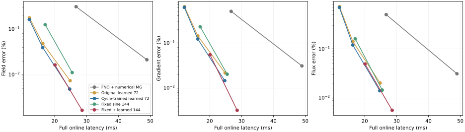
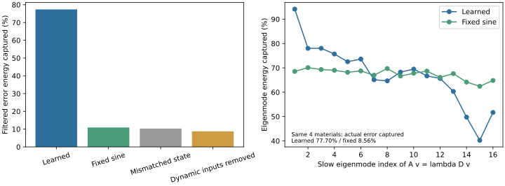

# 非均匀椭圆问题：机制深化与最终实验报告

日期：2026-11-03。范围：继承当前 Darcy 主方法，不再以一般 PDE 覆盖率作为目标。

## 研究主线

研究对象是材料变化的非均匀椭圆问题。固定物理滤波负责可局部消除的误差，条件化图响应空间负责剩余协同响应，真实细层方程决定空间中的组合。研究的核心是压缩逐材料数值工作，同时恢复场、导数和材料加权通量。

本轮只研究三个彼此相连的问题：

1. **作用机制：** 当前物理滤波留下什么，学习空间覆盖多少，剩余偏差来自空间表达还是能量标定目标？
2. **学习必要性：** 同维度固定正弦空间、材料错配空间以及去掉 NO/缺陷特征的空间分别如何，学习是否真正提供材料适应？
3. **执行与复用：** 单轮训练能否匹配实际两轮使用；在不增加部署操作的条件下，两轮训练是否改善精度；同材料不同载荷的空间能否复用？

## 固定条件与结果留痕

- 数据沿用 257² HANO 型六尺度材料及同网格 P1 标签；冻结原 FNO。
- 单次探索训练，48 个训练材料、12 个验证材料；选模仅使用验证集。
- 原图网络、72 维空间、64/8 预后滤波、真实 $A$ 标定和无 PCG 流程保持一致。
- 新训练改变的是目标：将实际固定两轮全部展开，联合监督两轮场／导数／通量输出。
- 成本比较在同设备同次运行中复测原权重、更新权重、固定空间，避免沿用历史机器负载下的时间排名。
- 离线最优系数使用真值，仅用于机制诊断；不作为部署结果。
- 原始 JSON、CSV、权重、日志保存于 `results/depth_20261103/`，完成结果不覆盖。

## 已完成的研究闭环

| 研究问题 | 已做实验 | 核心发现 |
| --- | --- | --- |
| 滤波留下什么 | 8 材料逐阶段诊断，4 材料精确慢谱分析 | 剩余误差有明显任务选择性，不等于一般几何低频 |
| 学习提供什么 | 固定空间、条件错配、移除动态输入，以及重新训练的材料单独条件控制 | 完整动态条件训练 K2 场误差0.03952%，材料单独条件0.15032% |
| 能否改进执行匹配 | 相同初始化、更新次数的单轮与两轮继续训练 | 继续优化带来主要提升，两轮展开另有约3%的K2收益 |
| 如何保留优点并改进结构 | 固定72＋学习72联合，与等维纯固定144对照 | 联合K2三项误差为0.01652%／0.05490%／0.04921% |
| 是否改善完整成本 | 32材料同GPU重测MG、全部响应空间；另有零初值MG | 联合K4比当前MG K4快1.71倍，三项误差同时降低 |
| 材料和载荷是否复用 | 8材料×3强度变换×3载荷，共72情况 | 可跨材料强度迁移；新变号载荷暴露未覆盖响应方向 |

当前保留**72维轻量学习空间**与**144维固定＋学习联合空间**两个配置。它们共享同一图网络和物理校准，不新增骨干模型。联合空间直接保留参考列与学习列，使用一个小系统共同决定系数。

## 实验条件

| 项目 | 本轮设置 |
| --- | --- |
| 方程与网格 | 单位方形、零Dirichlet、257×257节点、131072三角形、65025自由未知量 |
| 参考数据 | 原HANO型六尺度材料；先量化存储系数，再组装相同P1系统，生成对齐参考解 |
| NO | 冻结原四层FNO，width32、modes16、padding9，原训练150epochs |
| 图网络 | 原共享多层GNN，隐藏16、输出8、1912参数 |
| 校正 | 每轮64预滤波＋小空间投影＋8后滤波，模式整形2次，空间及分解只设置一次 |
| 训练 | 48 train／12 val；20epochs；seed20261103；AdamW，lr=$3\times10^{-4}$ |
| 测试 | 32个相同留出材料；batch1；RTX4090 GPU7；1次warmup、5次同步墙钟取median，再跨样本mean |
| 时间范围 | NO、材料细层构建、特征、图网络、空间整形和分解、全部校正；固定网格计划另列 |

没有PCG、阈值停止、数值回退或部署真值。所有配置各训练一次；重复计时不等于重复seed。

## 最终主结果

下表三项误差均为百分比，依次是质量加权场$L^2$、P1梯度$L^2$和材料加权通量$L^2$。

| 方法 | 场 | 导数 | 通量 | 完整在线ms |
| --- | ---: | ---: | ---: | ---: |
| FNO | 1.971102 | 44.325629 | 76.504427 | 1.592 |
| FNO＋MG K2 | 0.306556 | 0.499385 | 0.495318 | 26.716 |
| FNO＋MG K4 | 0.021413 | 0.031047 | 0.031183 | 48.937 |
| 原学习72 K2 | 0.048164 | 0.142902 | 0.140180 | 16.267 |
| 原学习72 K4 | 0.007499 | 0.021692 | 0.020267 | 24.833 |
| 更新学习72 K1 | 0.160563 | 0.609923 | 0.692059 | 12.039 |
| **更新学习72 K2** | **0.039456** | **0.122156** | **0.119312** | **16.241** |
| 更新学习72 K4 | 0.004916 | 0.014665 | 0.014114 | 24.712 |
| 固定72 K2 | 0.141752 | 0.260625 | 0.183874 | 13.285 |
| 固定72 K4 | 0.014594 | 0.026827 | 0.018665 | 21.515 |
| 固定144 K2 | 0.124239 | 0.227507 | 0.159856 | 17.011 |
| 固定144 K4 | 0.011282 | 0.020337 | 0.014556 | 25.493 |
| **联合144 K2** | **0.016518** | **0.054898** | **0.049214** | **20.090** |
| **联合144 K4** | **0.001700** | **0.003246** | **0.005660** | **28.608** |

更新72 K2对原72 K2降误差18.1%／14.5%／14.9%，32/32材料三项均改善。联合144 K2对等维纯固定144降误差86.7%／75.9%／69.2%，32/32材料三项均改善。联合144 K4对MG K4降误差92.1%／89.5%／81.8%，32/32材料三项和时间均改善。

数值MG是本项目精确因子化Galerkin实现＋细层CSR，粗层作用包含往返细层的传递。其范围和实现与当前方法一起公开。



另有[真实材料与误差空间分布图](results/depth_20261103/example_first_test/MATERIAL_AND_ERRORS.svg)：固定第一个测试材料，依次展示材料、GT场、GT通量，以及FNO／MG K2／联合K2的场和通量误差。各误差图使用共同对数色标，未按结果筛选样例。

## 训练控制与数值端点

| 方法 | 场% | 导数% | 通量% | 在线ms |
| --- | ---: | ---: | ---: | ---: |
| 同预算单轮继续训练，测试K2 | 0.040969 | 0.125644 | 0.122743 | 16.080 |
| 两轮展开训练，测试K2 | 0.039521 | 0.122143 | 0.119316 | 16.117 |
| 材料单独条件训练，测试K2 | 0.150323 | 0.293489 | 0.218686 | 16.283 |
| 同预算单轮继续训练，测试K4 | 0.005485 | 0.015965 | 0.015213 | 24.426 |
| 两轮展开训练，测试K4 | 0.004853 | 0.014706 | 0.014119 | 24.270 |
| 材料单独条件训练，测试K4 | 0.017780 | 0.036448 | 0.026560 | 24.687 |
| 零初值纯数值MG K2 | 1.470743 | 2.130068 | 2.025686 | 24.982 |
| 零初值纯数值MG K4 | 0.103195 | 0.133910 | 0.132015 | 46.734 |
| 零初值纯数值MG K8 | 0.001373 | 0.002263 | 0.004174 | 90.264 |

两轮展开对相同更新次数单轮控制的K2收益为3.53%／2.79%／2.79%，32/32材料三项均改善。完整条件对材料单独条件K2降误差73.7%／58.4%／45.4%，逐材料胜出32／32／30。

20epochs是相同参数更新次数。两轮展开训练循环约83.3秒，单轮约47.8秒，展开增加离线计算。相对旧权重的总体提升包含继续优化收益，不能全部归给展开目标。主表和控制表来自两次配对评测，保留GPU稀疏累加的小量浮点差别。

## 误差机制与离线诊断

8验证材料上，预滤波使导数／通量从45.38%／77.56%降至4.36%／5.24%；学习投影使场从1.5365%降至0.1907%；后滤波再使导数／通量降至0.6676%／0.7161%。局部滤波与空间响应有明确分工。

一次投影捕获滤波后能量：学习77.37%，固定10.92%，错配条件10.32%，直接移除动态输入8.76%。后两项是冻结网络敏感性干预；重新训练的材料单独条件控制见上表。

精确谱分析使用$Av_i=\lambda_iDv_i$，$v_i^{\mathsf T}Dv_j=\delta_{ij}$。最慢16模态能量占比由0.15%增至13.13%，总预滤波能量剩余约0.753%；学习与固定空间对16模态平均覆盖67.12%和67.43%。因此优势不等同于拥有更好的通用低频基。

补充完全配对核验：相同4材料、相同更新权重、相同真实方程下，实际滤波后误差覆盖为学习77.70%、固定8.56%，约9倍差异。对应原始记录为`spectral_matched4/spectral.json`，与慢模态分析属于同一批计算。

离线最优系数说明目标差别：同一学习空间中，最优场系数使投影后场误差从能量校准0.1907%降至0.1000%，通量却从2.6804%升至3.8634%；最优通量系数使通量降到2.5521%，场升到0.3539%。这些是后滤波前的真值辅助诊断。部署保留真实能量校准，用三输出联合训练塑造空间方向。



## 材料迁移与多载荷复用

8材料分别取$a^p$，$p=0.75,1,1.25$。先存储变换系数再独立生成参考，最大参考残差$1.99\times10^{-11}$；权重冻结。

三组材料对比度范围分别约$1.25\times10^3$–$3.20\times10^3$、$1.34\times10^4$–$4.71\times10^4$、$1.44\times10^5$–$6.94\times10^5$。最后一组为超出原材料强度范围的外推。

| 材料／载荷 | 学习72 场／导数／通量% | 联合144 场／导数／通量% | 固定144 场／导数／通量% |
| --- | --- | --- | --- |
| $a^{0.75}$，常载荷 | 0.03818／0.14084／0.13759 | 0.01292／0.05832／0.05544 | 0.31599／0.61097／0.43602 |
| $a$，常载荷 | 0.03932／0.12585／0.12549 | 0.01477／0.05150／0.04830 | 0.12900／0.25788／0.16754 |
| $a^{1.25}$，常载荷 | 0.34081／0.98099／0.98724 | 0.15118／0.46179／0.35648 | 1.50509／2.49622／1.40274 |
| $a$，正非均匀载荷 | 1.08534／2.88815／2.65169 | 0.45028／1.30463／1.10041 | 7.32320／10.98616／7.40854 |
| $a$，变号载荷 | 6.15870／8.92029／8.75991 | 3.24303／4.80551／4.28888 | 7.56454／10.92538／8.02585 |

新载荷为$1+0.8\cos(2\pi x)$与$\sin(2\pi x)\sin(\pi y)$，使用一致P1载荷积分。单位载荷条件下设置一次空间，新载荷统一零初值。全部72情况及滤波对照见[TRANSFER.csv](results/depth_20261103/TRANSFER.csv)。

复用记录的`apply_ms`只含已设置空间上的固定两轮，不含NO、材料构建、图网络和空间分解。当前表示有可迁移材料成分，但变号载荷暴露训练未覆盖方向；这明确了扩大载荷覆盖时应研究的对象。

## 时间与构建审计

| 独立阶段 | 学习72 ms | 联合144 ms |
| --- | ---: | ---: |
| FNO | 1.503 | 同左 |
| 当前材料细层构建 | 0.484 | 同左 |
| 一次预滤波64次 | 3.714 | 同左 |
| 动态特征 | 0.363 | 同左 |
| 图网络 | 2.814 | 同左 |
| 空间扩展、整形、Gram及分解 | 2.521 | 6.365 |
| 一次小空间投影 | 0.191 | 0.346 |
| 一次后滤波8次 | 0.467 | 0.466 |

来自GPU3上4材料的独立阶段中位数平均，不能直接相加代替GPU7完整延迟。联合空间增加的主要是一次设置成本。

本轮真实冷启动：网格图计划11.231秒、装配位置预编译1.504秒，可在固定网格复用。主评测原始`mesh_plan_ms_once`误记共享计划挂接约0.017ms，已在代码分离字段，以[cold_plan_audit](results/depth_20261103/cold_plan_audit/evaluation.json)单独记录真实冷启动。主表误差与完整在线延迟不受影响；[AUDIT.json](results/depth_20261103/AUDIT.json)说明该元数据修正。

固定$m,s,K$时，细层滤波$O(mN)$，$AZ$为$O(Ns)$，Gram为$O(Ns^2)$，小分解$O(s^3)$，投影$O(Ns+s^2)$。空间和分解跨轮次复用。

## 文献与叙事

本轮核对原始来源，将叙事收束到非均匀椭圆问题的材料响应和工作压缩：

| 工作 | 方法与启发 | 与当前工作的关系 |
| --- | --- | --- |
| [HINTS，NMI2024](https://www.nature.com/articles/s42256-024-00910-x) | 神经算子与松弛谱互补 | 当前学习方向空间，真实方程决定幅度 |
| [HANO，JCP2024](https://arxiv.org/abs/2210.10890) | 层级注意力、导数监督、多尺度材料 | 采用其材料分布，重新生成对齐标签 |
| [GMsFEM](https://arxiv.org/abs/1301.2866) | 材料谱空间、富集、多载荷复用 | 空间富集属于基础，本轮研究条件化学习及替代工作 |
| [GNN-AMG，ICML2020](https://proceedings.mlr.press/v119/luz20a.html) | 学习延拓 | 当前图层级传播特征，无材料数值粗层级 |
| [Operator compression](https://doi.org/10.1186/s13662-022-03702-y) | 学习材料到有效系统 | 当前保留细层真算子，学习响应列 |
| [LOD-MSNO](https://arxiv.org/html/2607.12570v1) | 学习LOD材料基与系数 | 当前系数在线来自真实方程，方向适应滤波后任务 |
| [Neural coarse solve](https://arxiv.org/html/2605.19867v3) | 固定粗基，比较输入离散和源项线性 | 当前学习对象为列空间，输入输出投影保持同一真实Galerkin结构 |

当前贡献链是：**刻画滤波后的任务选择性 → 用动态状态学习响应方向 → 保留参考方向并物理联合校准 → 替代递归工作 → 改善物理输出和完整成本。** 空间相加、能量投影和单位分解作为数值基础陈述。

## 结果位置与复现

| 文件 | 内容 |
| --- | --- |
| [depth_study.py](depth_study.py) | 训练、评测、机制、谱、迁移、分段时间 |
| [depth_report.py](depth_report.py) | 核验逐样本JSON、生成CSV和两张SVG |
| [SUMMARY.csv](results/depth_20261103/SUMMARY.csv) | 主表和控制工作点，含原始来源 |
| [PAIRED_COMPARISONS.csv](results/depth_20261103/PAIRED_COMPARISONS.csv) | 降误差比例、逐材料胜出 |
| [MECHANISM.csv](results/depth_20261103/MECHANISM.csv) | 阶段及最优投影诊断 |
| [TRANSFER.csv](results/depth_20261103/TRANSFER.csv) | 材料与载荷迁移 |
| `results/depth_20261103/cycle2_train/` | 更新模型、完整20epoch记录、命令及hash |
| `.../cycle1_control_train/`、`.../material_train/` | 两项训练控制 |
| `.../test32/`、`.../controls_test32/` | 全部32样本逐方法精度与时间 |
| `.../spectral_matched4/`、`.../profile4/` | 同权重同样本谱核验、阶段成本 |
| `.../example_first_test/` | 第一个真实测试材料的空间误差图及指标 |

数据和权重保留服务器，只有新源码上传；本地保存轻量结果与图。旧权重、旧结果未覆盖。

服务器`/data1/caohuilin/Graph`中运行，输出使用新名字：

```bash
export CUDA_VISIBLE_DEVICES=7 OMP_NUM_THREADS=2 OPENBLAS_NUM_THREADS=2
PY=/home/caohuilin/.conda/envs/gtmsmw/bin/python
EXP=CDMC/experiments/multiscale_elliptic_v1
DATA=baselines/data/multiscale_elliptic_v1/generated/n257_s20261023
OLD=$EXP/results/n257_s20261023
RUN=$EXP/results/depth_20261103

# 单轮控制改 --cycles 1；材料控制加 --conditioning material。
$PY -u $EXP/depth_study.py train --data "$DATA" --no-dir "$OLD/fno_l2" \
  --checkpoint "$OLD/regional_response_train_20261027/model.pt" \
  --out "$EXP/results/reproduce_cycle2" --cycles 2 --epochs 20

$PY -u $EXP/depth_study.py evaluate --data "$DATA" --no-dir "$OLD/fno_l2" \
  --checkpoint "$RUN/cycle2_train/model.pt" \
  --original "$OLD/regional_response_train_20261027/model.pt" \
  --out "$EXP/results/reproduce_evaluation" --count 32 --repeats 5

$PY $EXP/depth_report.py --root "$RUN"
```

## 论文与下一步

已重写[Nature中文初稿](../../reports/CDMC_NATURE_MANUSCRIPT_EXTENDED_20261027.md)，正文保留当前主线、机制、强对照、成本和迁移。旧门控、多PDE和强耦合分支完整[归档](../../reports/archive/CDMC_NATURE_MANUSCRIPT_BEFORE_DEPTH_20261103.md)。

接下来围绕同一椭圆方程族深化材料连通性与载荷方向覆盖。每个新设计先说明补充了哪些现有空间缺失的方向，再判断成本和收益。最终准出补充独立seed、更充分分辨率审计，以及独立优化数值实现。当前阶段不再铺开无关PDE分支。
