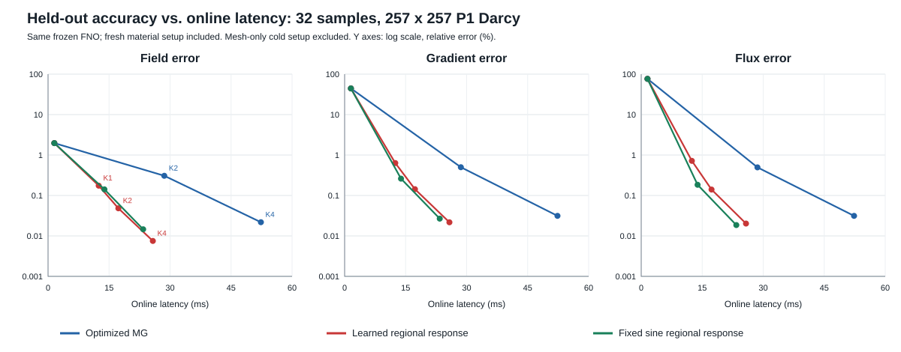

# 从叠加校正到替代数值工作：固定物理滤波与区域响应空间

实验开始：2026-10-27；整理：2026-10-28。旧 CDMC、联合粗空间和平衡保持传递实验全部保留；本报告记录本轮独立改进，不改写历史结果。

## 1. 已取得的成果

本轮实现了一个**不执行递归数值 MG、不构建材料 Galerkin 层级、不使用 PCG** 的校正流程。它保留精确细层物理作用，以固定次数物理滤波处理容易消除的误差，以图网络生成的区域响应空间处理剩余误差。

同一冻结 FNO、257×257 网格、32 个留出测试样本：

| 方法 | 场误差 % | 导数误差 % | 通量误差 % | 完整在线时间 ms |
| --- | ---: | ---: | ---: | ---: |
| FNO | 1.97110 | 44.32563 | 76.50443 | 1.541 |
| FNO + 同管线优化 MG，两轮 | 0.30678 | 0.49951 | 0.49535 | 28.579 |
| FNO + 旧 MG 两轮 + 联合空间 | 0.07551 | 0.29546 | 0.40504 | 43.665 |
| **本轮区域响应，两轮** | **0.04817** | **0.14292** | **0.14013** | **17.291** |
| FNO + 同管线优化 MG，四轮 | 0.02181 | 0.03133 | 0.03131 | 52.335 |
| **本轮区域响应，四轮** | **0.00751** | **0.02171** | **0.02021** | **25.764** |

“优化 MG”指将当前因子化 Galerkin MG 的细层作用换成精确 CSR 稀疏乘法，同时计入构建成本，不是工业 MG 的文献数字。在线时间包含重新执行 FNO、当前材料系统构建、空间设置和全部校正；网格计划另列。

- 两轮新流程相对优化 MG 两轮：场/导数/通量误差降低 **84.3% / 71.4% / 71.7%**，速度 **1.65 倍**；32/32 样本四项均胜出。
- 相对旧 MG 两轮+联合空间：速度 **2.53 倍**，场/导数/通量误差降低 **36.2% / 51.6% / 65.4%**。
- 四轮新流程相对优化 MG 四轮：三种平均误差降低 **65.6% / 30.7% / 35.4%**，速度 **2.03 倍**。逐样本场/导数/通量胜出为 30/32、24/32、26/32；时间 32/32 胜出。

## 2. 研究问题与实验对象

本轮研究：**在材料参数变化的椭圆方程族中，能否用较小的响应空间替代昂贵的多层数值工作，同时保住场、导数和通量精度？**

NO 在这里是已有的较好初值，不被当作人为构造的困难来源。重点从“完整 MG 后再增加网络”转向“识别必要物理工作，以及可以用学习替代的工作”。

继承现有多尺度 Darcy 数据，不新造闭合障碍或特殊失败材料。系数来自 HANO 六尺度三角乘积分布。真值由相同离散系统生成，避免过去粗网格残差与细网格下采样标签不对齐的问题。

| 项目 | 本轮设置 |
| --- | --- |
| 方程 | $-\nabla\cdot(a\nabla u)=1$；单位方形；零 Dirichlet 边界 |
| 网格 | 257×257 节点，131,072 个三角形，65,025 个自由未知量 |
| 材料 | 正系数、六尺度；完整测试集材料对比度约 $1.02\times10^4$ 至 $6.45\times10^4$ |
| 数据划分 | 512/64/64 个训练/验证/测试样本，独立参数向量 |
| FNO | 已训练四层 FNO，width=32、modes=16、padding=9；本轮冻结 |
| 校正训练 | 前 48 个训练样本，前 12 个验证样本；seed=20261027 |
| 结构诊断 | 前 4 个验证样本，选择固定滤波次数及响应空间 |
| 最终测试 | 前 32 个测试样本，局部索引 0–31，全局索引 576–607 |
| 硬件 | 服务器 GPU 6，NVIDIA RTX 4090；conda gtmsmw |
| 计时 | batch=1；CUDA 同步墙钟；1 次预热，7 次重复取中位数，再跨样本平均 |

该数据复现 HANO 的系数分布，**不是直接复现 HANO 发布标签**。三角形系数取三个存储节点系数的均值；同一 P1 系统生成 float64 高精度参考解，再以 float32 保存。生成器求解残差约 $10^{-11}$。

本文精度均相对 **257×257 的 P1 离散参考解**。已有 513×513 细化审计发现，细解限制到粗网格后与粗网格参考解相差约 9%。该离散偏差与本轮校正误差不同；0.00751% 不是连续 PDE 的同等精度。

## 3. 先诊断数值工作的本质

### 3.1 原因子化 MG 的成本来自哪里

当前 MG 为避免每个材料显式构建粗算子，采用

$$
A_\ell v=P_{0\leftarrow\ell}^{\mathsf T}A_0P_{0\leftarrow\ell}v.
$$

$A_0$ 是细层刚度矩阵，$P_{0\leftarrow\ell}$ 将第 $\ell$ 层向量提升到细层。因此每次粗层作用均要往返细网格。当前十层规模为

$$
65025,32513,16257,8129,4065,2033,1017,509,255,128.
$$

当前代码一轮包含 47 次细层算子作用，两轮为 94 次，此外还有层间传递。**这是当前实现的工作量，不是 MG 理论必须付出的固定成本。**

前 4 个测试样本的一次独立数值诊断如下。该诊断检查执行路径，不用于选择神经模型参数。

| 数值实现 | 场 % | 导数 % | 通量 % | 仅应用 ms | 当前材料额外设置 |
| --- | ---: | ---: | ---: | ---: | --- |
| 原因子化 MG K2 | 0.38575 | 0.59581 | 0.63611 | 37.002 | 旧因子化路径 |
| 显式存储 Galerkin MG K2 | 0.38643 | 0.59621 | 0.63659 | 4.151 | 3.03–4.71 秒 |
| 显式存储 Galerkin MG K4 | 0.02746 | 0.03773 | 0.03939 | 9.627 | 同上，可复用 |
| 所有层简单加性相加 K1 | 8.26176 | 30.77531 | 42.90868 | 0.705 | 诊断配置 |

“仅应用”不含 FNO、显式矩阵设置，不能直接与完整在线时间比较。两种 MG 小差异包含浮点累加及能量分母下限不同：诊断取 $10^{-20}$，旧求解路径取 $10^{-12}$。细层算子一致性已核验，未宣称逐位相同。

显式层级共有 11,642,465 个非零元，细层 453,137 个，算子复杂度约 25.7。结论：**材料固定、层级已缓存时，数值 MG 本身很快；材料逐样本变化时，设置和填充会成为代价。** 本轮替代方案针对后者。

### 3.2 为什么不能只删物理步骤

旧无 MG 的 8 模式模型在原 32 样本对照中，场/导数/通量误差为 1.16017% / 20.05229% / 42.89906%。只用少量神经模式，不能替代 MG 对粗糙误差的消除。

简单加性多层修正虽然便宜，却显著增大误差。因此本轮保留可控、便宜的细层物理滤波，替代递归粗层求解，而不是把全部数值操作删除。

## 4. 完整方法

### 4.1 离散系统与神经初值

消去 Dirichlet 自由度后，记当前材料的对称正定刚度矩阵为 $A\in\mathbb R^{N\times N}$，载荷为 $b\in\mathbb R^N$。参考解满足

$$
Ax^*=b.
$$

冻结 FNO 给出 $x^{(0)}$。令 $D=\operatorname{diag}(A)$。通过预编译的稀疏位置与 GPU 累加，只构建当前样本的细层 CSR、$D$、$b$ 和特征，不构建当前材料的 $A_1,\ldots,A_L$。

### 4.2 固定物理预滤波

从 $x^{(0)}$ 出发，执行固定 64 次 Chebyshev 半迭代，得到 $\bar x$。每次只需要稀疏 $Av$ 和对角缩放，没有 PCG 搜索方向、内积系数或误差阈值。

设滤波区间端点 $\ell=0.001$、$h=2$，中心 $d=(h+\ell)/2$，半径 $c=(h-\ell)/2$。误差传播写为

$$
\bar e=p_{64}(D^{-1}A)e^{(0)},\qquad
p_m(\lambda)=\frac{T_m((d-\lambda)/c)}{T_m(d/c)},
$$

$e^{(0)}=x^*-x^{(0)}$，$T_m$ 为 Chebyshev 多项式。对当前正标量扩散和直角三角形 P1 网格，归一化谱上界可取 2；$\ell$ 是滤波截止值，**不是最小特征值下界**。小特征值方向可能下降缓慢，交给后续响应空间处理。

### 4.3 共享多层图网络

网络输入为每个自由节点的 7 维信息：材料对数、对角元相对中位数的对数、两个坐标、节点质量相对中位数的对数、RMS 归一化的 $\bar x$、RMS 归一化的 $D^{-1}(b-A\bar x)$。

网络不是 CNN，也不是 8 个独立模型。结构依次为：

1. **特征提升：** 7 维输入经线性层和 GELU 映射为 width=16。
2. **下行传播：** 特征逐层池化，各层使用共享图消息块。
3. **上行融合：** 粗层特征提升，与对应下行特征拼接、线性融合，再执行共享图消息块。
4. **响应输出：** 映射为 8 个通道，提升回细网格，得到 $\Psi=[\psi_1,\ldots,\psi_8]$。

单个图块为

$$
H'=H+\operatorname{GELU}\!\left(\operatorname{LN}(HW_s+GHW_n+\beta)\right),
$$

$H$ 是节点特征，$G$ 是行归一化参考图邻接，$W_s,W_n,\beta$ 为参数。下行和上行分别共享各自权重。整个模型 **1,912 个参数**，从第一粗层开始运行，当前材料物理由原始 $A$ 提供。

图层级仅依赖网格。特征池化使用正权重平均，与实际投影使用的 $A$-能量内积不是同一个操作。这里保留的是神经层级传播，不是在线数值 V-cycle。

### 4.4 区域响应空间：改变方向，不只调步长

8 个全局系数意味着一个模式只能在整个网格上统一放大或缩小。不同区域需要不同响应时，缺少独立自由度。

取单位方形上的 3×3 个重叠帽函数 $w_j$，满足

$$
w_j\geq0,\qquad \sum_{j=1}^{9}w_j(x)=1.
$$

构造 72 个函数

$$
\widetilde z_{kj}(x)=w_j(x)\psi_k(x),\qquad k=1,\ldots,8.
$$

这不是将九块矩形数据拼成一个样本，也不是九个区域各自解 PDE。所有响应位于**同一个真实全域材料**上，通过一个联合小系统确定系数；区域之间的能量耦合完整保留。

再对全部 72 通道批量执行两次当前材料齐次 Jacobi 松弛：

$$
z^{(t+1)}=z^{(t)}-\frac23D^{-1}Az^{(t)},\qquad t=0,1.
$$

记此线性整形为 $H_A$。因为 $\sum_jw_j=1$，有

$$
H_A\psi_k=\sum_jH_A(w_j\psi_k).
$$

所以扩展空间包含原整形后的全局空间。它增加的是可表达的修正方向，而不只是某个已有更新的步长。理想最优近似因此不会因空间扩展而恶化；实际正则化投影和浮点计算另外检验。

### 4.5 在真实物理能量下联合标定

每列按 $A$-能量归一化，组成 $Z\in\mathbb R^{N\times72}$。设置一次

$$
G=Z^{\mathsf T}AZ,\qquad G_\eta=G+\eta I,\qquad \eta=10^{-5},
$$

并 Cholesky 分解 $G_\eta$。对当前状态 $x$，执行

$$
r=b-Ax,\qquad G_\eta c=Z^{\mathsf T}r,\qquad x^+=x+Zc.
$$

网络预测**修正空间**；系数由当前真实方程决定。它没有预测一个完整逆矩阵，也没有解全局 65,025 维 PCG 系统，但仍有一个 72×72 数值小系统。

在精确算术下，修正前误差 $e=x^*-x$ 满足

$$
\begin{aligned}
\|e-Zc\|_A^2
&=\|e\|_A^2-2c^{\mathsf T}Z^{\mathsf T}Ae+c^{\mathsf T}Gc\\
&=\|e\|_A^2-c^{\mathsf T}Gc-2\eta\|c\|_2^2.
\end{aligned}
$$

因此该投影减少离散能量误差。场 $L^2$、导数和通量是不同目标，本轮直接联合训练并分别评价。

### 4.6 后滤波、固定轮数与恢复场

投影后执行固定 8 次 Chebyshev 后滤波，截止值 0.05。一次轮次为

$$
x\xrightarrow{64\text{ 次预滤波}}\bar x
\xrightarrow{72\text{ 维联合投影}}x^+
\xrightarrow{8\text{ 次后滤波}}x_{\rm new}.
$$

网络与小矩阵**只在第一轮设置一次**。后续轮次复用 $Z$ 和 Cholesky 因子，重新计算当前残差和系数。K=2/4 表示固定重复 2/4 轮，不是 2/4 次稀疏乘法；每轮有 72 次滤波更新。没有阈值、回退或隐藏 PCG。

最后恢复边界和全场 $u$，在 P1 单元上计算梯度，通量为 $q=-a\nabla u$。

## 5. 训练及表示能力诊断

### 5.1 学习目标与预算

对完整的一轮预滤波—投影—后滤波求导，联合优化相对场、导数、通量误差：

$$
\mathcal L=\sqrt{(E_u^2+E_\nabla^2+E_q^2)/3}.
$$

三者都由参考场与相同 P1 几何计算；通量使用单元系数加权，不以界面上的傅里叶微分替代。FNO 完全冻结。

使用已有无 MG 模型热启动，再对全局 8 模式训练 20 epochs，最后对区域空间微调 20 epochs。全局阶段循环约 45.0 秒，区域阶段约 48.4 秒，包含其循环前缓存；不含先前 FNO/旧模型训练、网格计划、加载及全部评测成本。因此这不是从零、等预算的架构竞赛。

### 5.2 冻结模型的空间诊断

区域微调前，固定同一全局网络，只改变空间，对 4 个验证样本得到：

| 区域数 | 联合维度 | 场 % | 导数 % | 通量 % | 同空间最优场误差 %，离线 |
| ---: | ---: | ---: | ---: | ---: | ---: |
| 1 | 8 | 0.44640 | 1.09865 | 1.07598 | 0.36473 |
| 4 | 32 | 0.31541 | 0.94323 | 0.92095 | 0.23193 |
| 9 | 72 | 0.24131 | 0.78850 | 0.79022 | 0.11182 |

最后一列利用真值离线求最优场系数，位于后滤波前；只诊断表示能力，不进入在线方法。72 维在这四个样本中均保留 72 个数值独立方向。

证据分开了两个问题：**原全局空间确实缺少自由度；能量最优系数与场最优系数仍有差别。** 不能把全部误差归咎于训练不够或小系统求解不准。

## 6. 完整留出结果与强基线

以下均为 32 个样本的平均相对误差，单位 %。除从零三行外，都从相同 FNO 开始。

| 方法 | 场 % | 导数 % | 通量 % | 能量 % | 总时间 ms |
| --- | ---: | ---: | ---: | ---: | ---: |
| FNO | 1.97110 | 44.32563 | 76.50443 | 53.75018 | 1.541 |
| 原因子化 MG K2 | 0.30679 | 0.49953 | 0.49534 | 0.46603 | 39.181 |
| 细层 CSR 优化 MG K2 | 0.30678 | 0.49951 | 0.49535 | 0.46601 | 28.579 |
| 细层 CSR 优化 MG K4 | 0.02181 | 0.03133 | 0.03131 | 0.02900 | 52.335 |
| 从零 MG K2 | 1.47043 | 2.12983 | 2.02548 | 2.05499 | 26.368 |
| 从零 MG K4 | 0.10307 | 0.13380 | 0.13193 | 0.13074 | 48.906 |
| 从零 MG K8 | 0.00128 | 0.00217 | 0.00407 | 0.00280 | 93.426 |
| 旧空间门控 CDMC K2 | 0.24222 | 0.59001 | 0.71838 | 0.58270 | 38.966 |
| 旧 MG K2 + 联合 8 模式 | 0.07551 | 0.29546 | 0.40504 | 0.30975 | 43.665 |
| 区域学习空间 K1 | 0.17461 | 0.63304 | 0.71727 | 0.67346 | 12.455 |
| 区域学习空间 K2 | 0.04817 | 0.14292 | 0.14013 | 0.14274 | 17.291 |
| 区域学习空间 K4 | 0.00751 | 0.02171 | 0.02021 | 0.02127 | 25.764 |
| 全局学习 8 模式 K2 | 0.36119 | 0.69433 | 0.72058 | 0.70305 | 14.979 |
| 区域 POD 空间 K2 | 0.18570 | 0.34218 | 0.26209 | 0.30244 | 13.789 |
| 区域固定正弦空间 K2 | 0.14155 | 0.26051 | 0.18382 | 0.21944 | 13.861 |
| 仅 Chebyshev 144 次 | 1.03668 | 1.23119 | 1.25800 | 1.23899 | 10.643 |
| 仅 Chebyshev 288 次 | 0.88473 | 0.97148 | 1.00046 | 0.97748 | 19.368 |
| 区域 POD 空间 K4 | 0.02833 | 0.05505 | 0.04034 | 0.04776 | 23.314 |
| 区域固定正弦空间 K4 | 0.01458 | 0.02673 | 0.01855 | 0.02206 | 23.386 |

固定空间 K4 是同一测试集的补充对照，单独进程计时；标签和超参数不变。固定正弦用前 8 个低频二维正弦，经与神经模式相同的第一粗层投影、9 区域扩展、材料整形及联合标定。POD 只用 48 个训练样本预滤波后的实际误差，取质量加权前 8 个方向，再走相同流程；无验证或测试标签泄漏。

### 6.1 神经网络的实际贡献

- 对比仅滤波 144 次，学习 K2 将场误差由 1.03668% 降至 0.04817%，不是只降低残差。
- 对比全局 8 模式 K2，区域学习空间使三种误差同步下降；冻结模型诊断证明空间改动有独立收益。
- 对比区域固定正弦 K2，学习 K2 的场/导数/通量误差降低 66.0% / 45.1% / 23.8%，增加约 3.43 ms。
- 四轮固定正弦已很强：通量 0.01855% 优于学习版 0.02021%，且快约 2.38 ms；学习版场误差仍低约 48.5%，导数也更低。当前学习价值是有限轮次的响应覆盖与更低场误差，不是所有指标上不可替代。
- 从零 MG K8 达到更高精度，说明数值方法并未失去求解能力；其完整时间 93.426 ms，构成另一精度端点。

### 6.2 分位数

| 方法 | 场 mean / P95 % | 导数 mean / P95 % | 通量 mean / P95 % |
| --- | ---: | ---: | ---: |
| 优化 MG K2 | 0.30678 / 0.59861 | 0.49951 / 0.78555 | 0.49535 / 0.81101 |
| 区域学习 K2 | **0.04817 / 0.08984** | **0.14292 / 0.23783** | **0.14013 / 0.21233** |
| 优化 MG K4 | 0.02181 / 0.04210 | 0.03133 / 0.05957 | 0.03131 / 0.05857 |
| 区域学习 K4 | **0.00751 / 0.01431** | **0.02171 / 0.04525** | **0.02021 / 0.03653** |

## 7. 时间开销与复杂度

### 7.1 执行阶段

独立测量 K1 各阶段，32 样本平均：

| 阶段 | 计算内容 | ms |
| --- | --- | ---: |
| FNO | 重新运行冻结预测器 | 1.494 |
| 当前材料细系统 | CSR 数值、右端项、对角元和特征 | 0.459 |
| 预滤波 | 64 次细层 Chebyshev | 3.770 |
| 特征 | 当前缺陷、归一化、多层池化 | 0.366 |
| 响应设置 | 图网络、区域扩展、整形、Gram 及 Cholesky | 5.246 |
| 联合更新 | 残差、72 维系数、加回响应 | 0.194 |
| 后滤波 | 8 次细层 Chebyshev | 0.486 |

各阶段分别预热同步，不能把其和当作完整时间。真实完整时间为 K1=12.455、K2=17.291、K4=25.764 ms。后续轮次复用响应设置，主要增加物理滤波和小系统应用。

### 7.2 冷启动与逐材料成本

最终评测进程记录：网格计划 5.785 秒，细层装配位置计划 1.473 秒。图上下文及模型加载也在热路径之外，所以二者之和并非完整冷启动。

这些计划依赖固定网格，可跨材料复用；新材料细系统构建仍已计入在线时间，约 0.459 ms。17.291/25.764 ms 对应**网格已准备、逐样本更换材料**，不是新网格第一个样本的全部耗时。

显式 Galerkin MG 在同一材料的层级已经缓存时只有几毫秒应用时间。本轮减少的是变材料下的层级设置及递归执行，不把当前加速解释成超过所有缓存后的成熟 MG/AMG。

### 7.3 复杂度

设 $N$ 为未知量，$s=72$ 为空间维度，$K$ 为固定轮数，$m=72$ 为每轮滤波次数，宽度 $w=16$。稀疏度有界时：

| 工作 | 复杂度 |
| --- | --- |
| 当前材料细系统 | $O(N)$ |
| 图网络 | $O(\sum_\ell |E_\ell|w+\sum_\ell N_\ell w^2)$ |
| 整形及 $AZ$ | $O(Ns)$ |
| 小 Gram | $O(Ns^2)$ |
| 小系统分解 | $O(s^3)$ |
| 每轮滤波与投影 | $O(mN+Ns+s^2)$ |
| 响应存储 | $O(Ns)$ |

固定 $s,w,m,K$ 时近似线性随 $N$ 增长，但不是比最优 MG 更低的渐近阶。收益来自移除材料多层矩阵、减少串行往返、批量计算响应。若更大问题需要 $s$ 增长，$Ns^2$ 将成为新瓶颈，应先检验覆盖能力，不直接堆模式数。

## 8. 相关工作与本轮独立价值

| 工作 | 已有思想 | 与本轮的关系 |
| --- | --- | --- |
| HINTS，NMI 2024 [1] | 神经算子和数值松弛的谱互补 | 滤波+网络处理困难误差的大结构已有先例 |
| FNS，JCP 2025 [2] | 学习平滑难以消除的特征方向；互补训练 | 不能把“网络学低频”或交替迭代视为首次贡献 |
| NGO 粗空间分析，2026 [3] | 同基积分、源项线性及 Galerkin 型校正 | 当前 $Z^Tr$ 与 $Zc$ 也是同空间变分结构 |
| RAPNet，ICML 2026 [4] | 学习稀疏粗算子，降低 AMG 粗层复杂度 | 本轮不学习保留的 $A_\ell$，而直接移除材料层级 |
| 层级单位分解网络，2022 [5] | 局部近似空间与层级组织 | 单位分解、富集及小 Galerkin 系统有经典基础 |

本轮明确新增了一个已实现、经强对照验证的组合：**依据当前材料及实际缺陷生成共享图响应，以区域系数释放表达自由度，用原方程的小能量系统定标，实际替代递归数值 MG。** 相比旧门控版，在线工作组织发生实质变化，而非给完整 MG 多加一项。

下一步研究焦点也更具体：**如何以小而可迁移的表示捕捉物理滤波后的困难响应，使学习空间在同成本下持续优于固定空间？** 区域覆盖收益已成立；两轮学习收益明显，四轮通量尚不优于固定空间。应围绕这一表示机制做跨材料/网格检验，而不是无目的叠模块。

这是单一线性正定方程族、固定网格、一个 seed 的新精度—成本工作点；尚未把它当成一般非线性/非对称 PDE 的完成验证。本文理论减少的是该离散问题的能量误差，泛化和创新性需与上述近邻方法继续实证区分。

## 9. 文件与复现

| 文件/目录 | 内容 |
| --- | --- |
| [polynomial_joint.py](polynomial_joint.py) | 滤波、训练、区域响应与强基线评测 |
| [replacement_study.py](replacement_study.py) | 因子化/显式存储/加性数值诊断 |
| [coupled_coarse.py](coupled_coarse.py) | 复用图网络、整形与变分标定 |
| [最终结构化总表](results/REPLACEMENT_SUMMARY_20261028.csv) | 19 个工作点，误差、时间、样本数及来源 |
| [三指标曲线](results/REPLACEMENT_ACCURACY_TIME_20261028.svg) | 从留出数据生成的精度—耗时关系 |
| [最终主评测 JSON](results/n257_s20261023/regional_response_test32_20261027/evaluation.json) | 逐样本、分位数、分段时间及配置 |
| [固定空间四轮 JSON](results/n257_s20261023/fixed_space_k4_test32_20261028/evaluation.json) | 同样本非神经强对照 |
| [冻结空间诊断](results/n257_s20261023/polynomial_space_diagnosis_20261027/space_diagnosis.json) | 维度、数值秩、离线最优系数 |
| [区域训练](results/n257_s20261023/regional_response_train_20261027/training.json) | 20 epochs 学习曲线 |

数据和权重保留服务器，仅回传小型结果。所有远程改动局限于 /data1/caohuilin/Graph 项目目录，没有安装本地 torch 或改动其他用户任务。

在服务器项目根目录运行；输出目录需新命名，不覆盖已完成记录：

~~~bash
export CUDA_VISIBLE_DEVICES=6 OMP_NUM_THREADS=2 OPENBLAS_NUM_THREADS=2
PY=/home/caohuilin/.conda/envs/gtmsmw/bin/python
EXP=CDMC/experiments/multiscale_elliptic_v1
DATA=baselines/data/multiscale_elliptic_v1/generated/n257_s20261023
R=$EXP/results/n257_s20261023

# 区域微调，继承本轮已训练的全局模型，FNO 冻结。
$PY -u $EXP/polynomial_joint.py train \
  --data "$DATA" --no-dir "$R/fno_l2" \
  --initialize "$R/polynomial_joint_train_20261027/model.pt" \
  --out "$R/regional_response_train_reproduction" \
  --pre 64 --post 8 --partition-grid 3 \
  --epochs 20 --train-count 48 --val-count 12

# 最终主表，复用正式权重。
$PY -u $EXP/polynomial_joint.py evaluate \
  --data "$DATA" --no-dir "$R/fno_l2" \
  --checkpoint "$R/regional_response_train_20261027/model.pt" \
  --global-checkpoint "$R/polynomial_joint_train_20261027/model.pt" \
  --pod-checkpoint "$R/regional_response_train_20261027/pod.pt" \
  --old-joint-checkpoint "$R/coupled_actual/coupled.pt" \
  --old-cdmc-checkpoint "$R/actual/cdmc.pt" \
  --out "$R/regional_response_test32_reproduction" \
  --split test --count 32 --repeats 7 \
  --methods FNO MG_K2 MG_CSR_K2 MG_CSR_K4 \
  MG_CSR_zero_K2 MG_CSR_zero_K4 MG_CSR_zero_K8 \
  old_CDMC_K2 old_MG_joint_K2 \
  learned_replacement_K1 learned_replacement_K2 learned_replacement_K4 \
  global_response_K2 POD_response_K2 geometric_response_K2 poly144 poly288

# 同轮数固定空间强对照。
$PY -u $EXP/polynomial_joint.py evaluate \
  --data "$DATA" --no-dir "$R/fno_l2" \
  --checkpoint "$R/regional_response_train_20261027/model.pt" \
  --pod-checkpoint "$R/regional_response_train_20261027/pod.pt" \
  --out "$R/fixed_space_k4_reproduction" \
  --split test --count 32 --repeats 7 \
  --methods POD_response_K4 geometric_response_K4
~~~

主测试脚本 SHA256：b86fb00912a4d4e92cd74aa3019d551ec6de12830173d370dd95624cc0bbde26。补充 K4 方法名称后的最终 SHA256：e7857f555d17394d8cb3b286b0f2cd400ffca234f3e0e3144f2e124e06afcb29。二者计算公式相同，仅新开放两个固定空间的 K4 名称。诊断脚本 SHA256：3c72d9f5510f92811d87435227403cd2a7cb582bb0bc57ea466c01119d5cd74c。

## 参考文献

1. Zhang et al. *Blending neural operators and relaxation methods in PDE numerical solvers*. Nature Machine Intelligence 6, 1303–1313 (2024). DOI: 10.1038/s42256-024-00910-x。
2. Cui, Jiang, Liu & Shu. *A Hybrid Iterative Neural Solver Based on Spectral Analysis for Parametric PDEs*. JCP (2025), DOI: 10.1016/j.jcp.2025.114165；arXiv:2408.08540v3。
3. Melchers, Dolean & Abdelmalik. *When can a neural operator replace a coarse solve? Architectural principles for two-level preconditioning*. arXiv:2605.19867v3 (2026)。
4. Fink, Ben-Yair, Ruthotto & Treister. *RAPNet: Accelerating Algebraic Multigrid with Learned Sparse Corrections*. ICML 2026, PMLR 306:31125–31145。
5. Trask, Henriksen, Martinez & Cyr. *Hierarchical partition of unity networks: fast multilevel training*. MSML 2022, PMLR 190:271–286。
