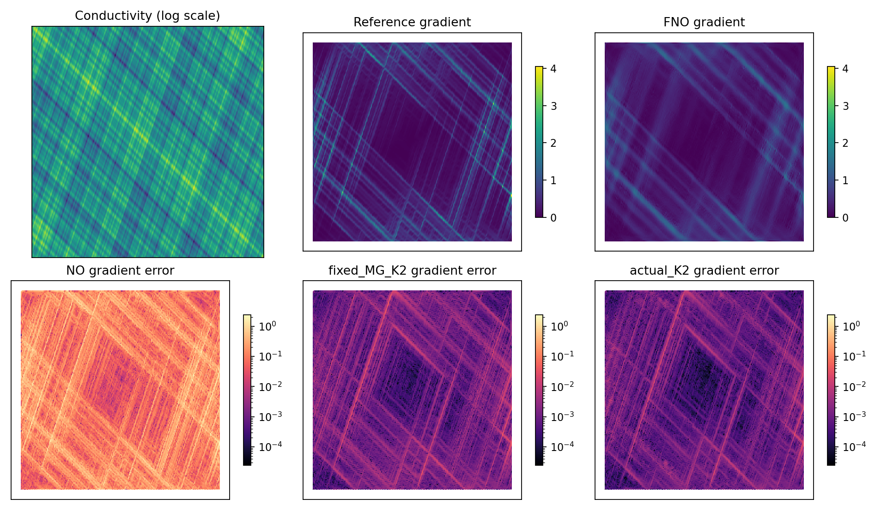
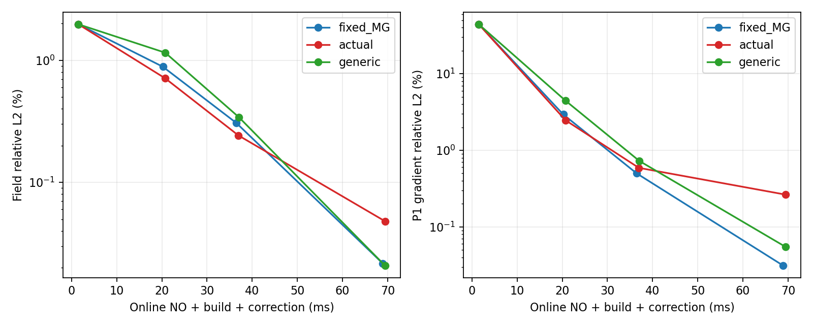
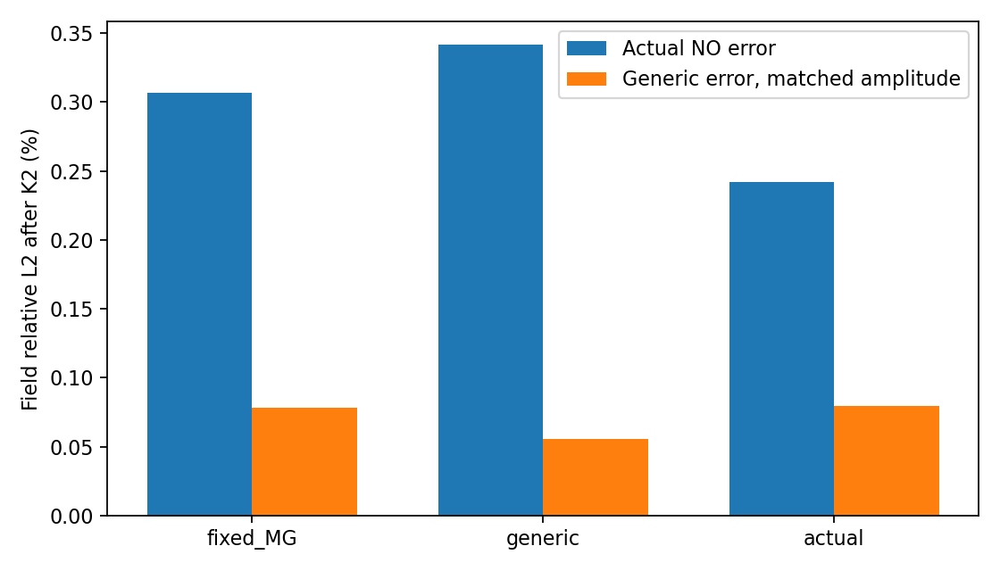

# 多尺度材料中的互补缺陷：典型例子验证结果

日期：2026-10-23。代码、数据协议及复现入口见 [README](README.md)。本轮使用服务器现有 conda 环境，完成一次 seed 的训练、独立留出测试、成熟数值对照和失败机制审计。原 CDMC v2 源码与旧结果均未覆盖。

## 1. 本轮判断

**这个例子清楚展示了“NO 场预测准确，但导数和物质通量仍有大误差”；真实 NO 缺陷训练也确实优于通用误差训练。但是当前图设置尚未超过训练集校准的单个松弛参数，因此本轮支持问题和任务分布效应，尚未建立空间自适应设置的独特优势。**

| 要验证的内容 | 观测结果 | 研究结论 |
| --- | --- | --- |
| 优秀场预测是否仍遗漏局部结构 | FNO 场误差 1.9711%，导数误差 44.3256%，通量误差 76.5044% | 现象鲜明，适合作为切入例子 |
| 针对真实 NO 缺陷训练是否更有效 | 同骨架、同预算 K2：Actual 0.24221%，Generic 0.34151% | 场误差再降 29.08%，31/32 样本胜出 |
| 优势是否来自空间图设置 | 训练集均值标量门控 K2 为 0.23391%，略好于图设置 | 当前收益主要可由松弛尺度解释，空间作用仍需建立 |
| 能否直接增加循环 | K4 图设置均值差于固定 MG；两例更新停滞 | 已定位高对比材料上的粗层平滑稳定性问题 |
| 强数值方法是否无法处理 | 自适应 AMG 能显著提高精度，收敛求解达到近参考精度 | 数值方法的优势是精度；需要比较逐材料设置和复用方式 |
| 当前空间分辨率是否足够 | 257 与限制后的 513 解相差约 9% | 本轮是同一离散系统的机制证据；主物理实验还需分辨率收敛 |

## 2. 数据、模型与比较条件

### 2.1 方程与真值

在单位方形上求解

$$
-\nabla\cdot(a\nabla u)=1,\qquad u|_{\partial\Omega}=0.
$$

系数分布来自 [HANO §3.1.2](https://arxiv.org/html/2210.10890) 的六尺度三角乘积。在原坐标 $X=2x-1,\ Y=2y-1$ 下，

$$
a(x,y)=\prod_{k=1}^{6}
\left[1+\frac12\cos\big(\alpha_k\pi(X+Y)\big)\right]
\left[1+\frac12\sin\big(\alpha_k\pi(Y-3X)\big)\right],
\qquad
\alpha_k\sim\mathcal U(2^{k-1},1.5\,2^{k-1}).
$$

原域到单位域的解缩放为 $u_{\rm unit}=u_{\rm original}/4$，因而源项仍为 1。本轮重新生成 P1-FEM 真值；节点系数先保存为 float32，再以这些相同系数组装 float64 参考系统。单元系数取三个节点系数的平均。NO、CDMC 和数值基线面对相同的离散问题。

| 条件 | 设置 |
| --- | --- |
| 网格 | 257×257 节点、131072 个 P1 三角形、65025 个内部自由度 |
| NO 数据 | 512 训练 / 64 验证 / 64 测试，互不重叠 |
| 主要留出评测 | 前 32 个测试样本；CPU 强基线使用其中前 16 个 |
| 材料节点对比度 | 测试集约 10244–64451 |
| 种子 | 20261023；快速机制验证不重复训练 seed |
| 参考求解 | float64 直接解；测试最大相对残差约 $1.01\times10^{-11}$ |
| 硬件 | 神经模型与本方法：RTX 4090；PyAMG：服务器 CPU，2 线程设置 |

数据采用 HANO 的**系数分布**，而非其原始细网格下采样标签。这里的数值不与 HANO 论文表格作直接排名。

### 2.2 NO 与 CDMC

NO 为标准 FNO：3 通道输入（归一化 log 系数及坐标），线性提升，4 个 Fourier+逐点线性块，width=32、modes=16、padding=9，最后经 128 维投影输出标量场。训练 150 epochs，约 210.6 万参数。边界严格置零。

另训练同结构、同数据、同种子的导数监督 FNO，损失为场相对误差加 0.1 倍有限差分导数相对误差。评测中的导数则统一按 P1 单元梯度计算。

CDMC 复用现有 v2 主干：

1. 从 NO 场与当前系数构造准确的离散残差。
2. 6 维节点特征输入 width=32 的图设置网络：线性提升、两次“自身线性+邻居聚合”的残差消息传递、输出平滑门控。
3. 图设置仅执行一次，在后续循环中复用。门控范围为 $(0.5,1.5)$；粗层门控固定为 1。
4. 使用完整 V-cycle，各层前后各两步平滑，末层按当前材料 Galerkin 系统直接 Cholesky 求解。主方法没有 PCG。
5. 每轮采用原 v2 的能量步长更新。网格层次为 65025→32513→16257→8129→4065→2033→1017→509→255→128。

中间层的算子作用是因子化 Galerkin；中间层平滑对角采用 v2 的参考层尺度近似，而非逐材料完整组装。这一区别是本轮稳定性审计的关键。

Actual 与 Generic 的网络、初始化、样本次序、优化器和训练量相同：48 训练样本、12 验证样本、20 epochs。损失平均 K1/K2 场误差，按各自验证任务的 K2 选模。这个损失不同于旧最强多尺度实验的 K2-only 设置，本轮未将两者混称。

- **Actual**：从冻结 NO 的实际预测开始训练。
- **Generic**：从真值减去随机低/中/高频正弦混合误差开始；每个样本的初始误差质量范数与 Actual 相同。它学习通用误差方向，而不是 NO 实际误差方向。

Generic 的构造使用训练/验证真值，不使用测试真值做部署预测。两者主测试均从同一个真实 NO 输出开始。

## 3. 主要结果：同一 NO、32 个留出样本

误差均为逐样本相对误差百分比的算术平均；K 表示完整 V-cycle 次数。导数为单元梯度，通量为 $q=-a\nabla u$。

| 方法 | 场误差 % | 导数误差 % | 通量误差 % | 完整在线时间 ms |
| --- | ---: | ---: | ---: | ---: |
| FNO | 1.97110 | 44.32563 | 76.50443 | 1.483 |
| 零初值固定 MG，K2 | 1.47078 | 2.13013 | 2.02572 | 34.734 |
| FNO + 固定 MG，K1 | 0.88450 | 2.93897 | 3.68408 | 20.218 |
| FNO + Actual CDMC，K1 | 0.71162 | 2.46779 | 3.30162 | 20.719 |
| FNO + 固定 MG，K2 | 0.30683 | 0.49956 | 0.49535 | 36.474 |
| FNO + Generic CDMC，K2 | 0.34151 | 0.72650 | 0.85341 | 37.062 |
| **FNO + Actual CDMC，K2** | **0.24221** | **0.59001** | **0.71838** | **36.961** |
| FNO + 固定 MG，K4 | 0.02169 | 0.03119 | 0.03100 | 68.931 |
| FNO + Generic CDMC，K4 | 0.02082 | 0.05493 | 0.12971 | 69.433 |
| FNO + Actual CDMC，K4 | 0.04804 | 0.26381 | 0.30738 | 69.444 |

K2 Actual 相对 NO 的场误差降低 **87.71%**，相对固定 MG 降低 **21.06%**，相对 Generic 降低 **29.08%**。对固定 MG 为 30/32 样本胜出，对 Generic 为 31/32。相对固定 MG 的额外在线时间约 **0.487 ms**。

场误差收益和导数收益并不完全一致：K2 Actual 的导数均值反而高于固定 MG。其导数中位数为 0.33927%，固定 MG 为 0.47415%；少数失效样本拉高了均值。主表保留这些样本。

上图固定使用测试样本 0，不按收益挑图。梯度预测共用线性色标，三个梯度误差图共用对数色标。FNO 保留大结构，但丢失细条纹导数；数值与学习校正都能明显恢复它们。

## 4. 真实缺陷与通用方向的交换测试

在同一批 32 个测试算子上，离线构造与 NO 误差质量范数相同的随机误差，比较方向变化的影响。此诊断使用测试真值构造反事实初值，**不属于部署预测**。

| 校正设置 | 实际 NO 初值，K2 场误差 % | 同幅值通用误差初值，K2 场误差 % |
| --- | ---: | ---: |
| 固定 MG | 0.30683 | 0.07808 |
| Generic 训练 | 0.34151 | **0.05530** |
| Actual 训练 | **0.24221** | 0.07973 |

训练分布与误差方向发生交换时，优势也发生交换。**误差幅度相同，不代表有限计算量下的求解难度相同。** 这支持“NO 定义了剩余计算任务”的叙事，但还需要下一节对照来判断网络到底学到了什么。

## 5. 单个松弛参数对照：空间设置的实际贡献

将 Actual 网络在 48 个训练样本上的门控均值取平均，得到固定值 **1.21707985**。测试阶段所有节点、所有样本均使用这个标量，经相同正值转移传到各层；没有测试集参数搜索，也不再执行图网络。

| 设置 | K1 场误差 % | K2 场误差 % | K4 场误差 % | K2 导数误差 % |
| --- | ---: | ---: | ---: | ---: |
| 固定门控 1 | 0.88450 | 0.30683 | 0.02169 | 0.49956 |
| 训练集平均标量 1.21708 | 0.72354 | **0.23391** | **0.02578** | **0.42548** |
| Actual 图设置 | **0.71162** | 0.24221 | 0.04804 | 0.59001 |

单个训练集校准的松弛参数在 K2 上比图设置还低约 3.43%。因此，本轮 Actual 对 Generic 的收益可以主要解释为**任务匹配的松弛尺度学习**。当前结果没有证明复杂的空间门控比这一简单对照更有效；这一对照应继续保留在论文实验中。

## 6. 导数监督 FNO：改进 NO 后是否仍有校正任务

同样使用 32 个测试样本。这里的 CDMC 专门在导数监督 FNO 的真实缺陷上训练；不是冻结迁移的 16 样本结果。

| 方法 | 场误差 % | 导数误差 % | 完整在线时间 ms |
| --- | ---: | ---: | ---: |
| 导数监督 FNO | 1.92358 | 40.62737 | 1.477 |
| + 固定 MG，K1 | 0.80979 | 2.59600 | 19.834 |
| + Actual CDMC，K1 | 0.66731 | 2.25650 | 20.324 |
| + 固定 MG，K2 | 0.27054 | 0.45381 | 35.676 |
| + Actual CDMC，K2 | 0.22751 | 0.61626 | 36.225 |
| + 固定 MG，K4 | 0.01918 | 0.02827 | 67.368 |
| + Actual CDMC，K4 | 0.05607 | 0.31890 | 67.922 |

K2 场误差相对固定 MG 再降低 15.90%，30/32 样本胜出；相同材料上的停滞问题仍然出现。导数监督缓解了初始误差，但没有消除当前骨架的稳定性问题。

另有冻结 L2-NO 校正器迁移到导数监督 NO 的 16 样本测试。在相同前 16 样本上，迁移校正 K2 为 0.19986%，专门训练为 0.19960%；两者接近。详见 `evaluation_h1_transfer`，不把这组 16 样本均值与 32 样本均值直接比较。

## 7. 成熟数值基线：相同前 16 个测试算子

采用环境已有 PyAMG 5.3.0，测试 smoothed aggregation、Ruge–Stüben，以及两候选向量的 adaptive smoothed aggregation。三者均在当前材料上重新设置层次；收敛精度端点使用 AMG 预条件 CG。这些 CG 只属于数值对照。

### 7.1 精度与分段时间

| 基线 | 初值 | 次数 | 场误差 % | CPU 求解 ms | CPU 组装+设置+求解 ms |
| --- | --- | --- | ---: | ---: | ---: |
| SA-AMG | 零 | 2 | 33.7900 | 13.531 | 256.761 |
| SA-AMG | 同一 FNO | 2 | 0.89295 | 13.586 | 256.816 |
| RS-AMG | 零 | 2 | 51.2205 | 14.440 | 148.557 |
| RS-AMG | 同一 FNO | 2 | 0.64348 | 14.392 | 148.509 |
| **Adaptive SA-AMG** | 同一 FNO | 1 | **0.27218** | **17.419** | **1927.278** |
| **Adaptive SA-AMG** | 同一 FNO | 2 | **0.08414** | **34.054** | **1943.913** |
| Adaptive SA-AMG | 同一 FNO | 4 | 0.01158 | 67.517 | 1977.376 |
| SA-AMG-CG | 零 | 收敛 | $4.03\times10^{-6}$ | 213.490 | 456.719 |
| RS-AMG-CG | 零 | 收敛 | $4.03\times10^{-6}$ | 201.336 | 335.453 |
| Adaptive SA-AMG-CG | 零 | 收敛 | $4.03\times10^{-6}$ | 286.824 | 2196.683 |

同样的前 16 样本上，GPU 固定 MG K2 为 **0.32540% / 36.440 ms**，Actual CDMC K2 为 **0.22508% / 36.957 ms**。Adaptive SA-AMG 的 K2 精度更好。

CPU 最后一列不含 FNO 的 GPU 推理及设备传输；它是数值部分 CPU 成本，而不是完整混合系统在线时间。固定循环时间为预热后三次中位数；CG 收敛端点计时一次。当前数据不提供同硬件、同精度的 CPU/GPU 加速比。

### 7.2 设置代价与适用场景

| 数值方法 | 每材料 CPU 组装 ms | 每材料 AMG 设置 ms | 算子复杂度 |
| --- | ---: | ---: | ---: |
| SA | 70.398 | 172.832 | 1.131 |
| RS | 70.614 | 63.503 | 1.844 |
| Adaptive SA | 78.132 | 1831.727 | 2.465 |

Adaptive SA 用更强的材料相关候选空间，换取更准确的有限轮修正。CDMC 复用网格计划，并在每材料约 1.79 ms 构建当前样本系统，这是值得继续比较的设置成本差异。如果同一材料用于大量 RHS，AMG 设置也能复用，比较应以复用后的求解成本为主。

CPU 组装复用了数据生成器的 P1 组装实现；这里将其单独列出，不把该实现的 CPU 组装速度当作成熟 FEM 软件的性能上限。

## 8. 时间实际花在何处

| 阶段 | 32 样本平均时间 | 是否每个材料重复 |
| --- | ---: | --- |
| 网格/参考层次/终层几何计划 | 5.155 s | 同网格一次 |
| FNO 场预测 | 1.483 ms | 是 |
| 当前材料系统构建（含末层分解） | 1.792 ms | 是 |
| Actual 图设置+K1 循环，已构建系统 | 17.190 ms | 是 |
| Actual 图设置+K2 循环，已构建系统 | 33.395 ms | 是 |
| Actual 图设置+K4 循环，已构建系统 | 65.711 ms | 是 |
| 完整 NO+构建+图设置+K2 | 36.961 ms | 是 |

完整在线时间每次重新执行 NO、材料系统构建、一次图设置与 K 轮更新，不复用先前迭代结果；输入已驻留 GPU。误差计算、CPU 转移出图不计入求解时间。分段与端到端分别计时，均值不要求逐项严格相加。

本例有十层，因子化粗层算子作用要回到细层再限制，循环耗时随 K 近似线性。相较单次 FNO，主要成本是多层数值算子作用，而不是图设置；当前配置没有达到 one-shot 附近的成本。

## 9. 异常样本的根因

令第 $\ell$ 层的平滑更新为

$$
x\leftarrow x+D_{g,\ell}(b_\ell-A_\ell x),\qquad
D_{g,\ell}=\omega_\ell\operatorname{diag}(g_\ell)\widetilde D_\ell^{-1}.
$$

稳定性取决于 $D_{g,\ell}^{1/2}A_\ell D_{g,\ell}^{1/2}$ 的最大特征值是否小于 2。这里 $\widetilde D_\ell$ 是参考层尺度近似，并非当前材料的精确粗层对角。高对比材料使这一近似偏离，接近 1.2 的学习门控又扩大了不稳定模态。

离线幂迭代得到的 Rayleigh 值是最大特征值的下界；**大于 2 足以证明平滑器有放大模态，小于 2 不能独立作为上界保证**。

| 测试索引（从 0 起） | 固定设置最大 Rayleigh | 学习设置最大 Rayleigh | 整轮更新现象 |
| --- | ---: | ---: | --- |
| 0，固定展示样本 | 1.963 | 2.305 | 四轮仍更新 |
| 30，最严重异常 | 2.348 | 3.019 | K2–K4 步长为 0 |
| 22，第二异常 | 2.164 | 2.685 | K4 步长为 0 |

样本 30 在第 2 轮的 $r^Td=-6.52\times10^{-4}$。现有能量步长将负方向截为零，场误差停在约 1.07966%，后续重复循环不再改善。它在导数监督 NO 上也发生，因此不能归因于某一个 NO 权重偶然较差。

这是明确的**材料相关数值尺度近似与学习门控的相互作用**，不是“测试多几轮就会好”。固定设置在部分粗层也存在放大模态，因而仅把学习门控压小并不能给整个骨架提供统一稳定性保证。

## 10. 离散误差与物理参考

| 测试参数 | 257 解与限制后的 513 解的场差异 % |
| --- | ---: |
| 0 | 9.42865 |
| 1 | 8.95708 |
| 2 | 9.50971 |

上表比较在同一解析系数参数下重新采样、重新求解的两套网格。约 9% 的差异同时反映系数解析尺度与空间离散的分辨问题。它与同一离散系统的 float64 求解残差约 $10^{-11}$ 是不同层面的误差。

当前 CDMC 的 0.24% 是相对 257 网格 P1 参考解的代数场误差，并不表示已达到连续多尺度问题 0.24% 的误差。这个例子若作为主物理实验，应先完成更充分的空间收敛核验，再固定训练标签和校正的对齐方式。

## 11. 下一步的明确取舍

保留这个例子及全部对照，不通过换测试子集或削弱数值基线制造优势。下一步的优先级由本轮证据决定：

1. **先修复多层平滑的材料相关稳定尺度。** 这是导致循环停滞的已证实原因，优先于增加网络或训练 seed。
2. **以训练集标量校准作为必须胜过的基线。** 空间图设置应在稳定骨架上证明超越标量松弛的作用，才适合支撑“学习互补结构”的方法主张。
3. **与 Adaptive SA 比较空间能力及设置成本。** 当前强数值方法能降低这些误差；研究机会在于能否借助 NO 剩余任务减少逐材料复杂设置，而不是宣称传统方法无法求解。
4. **在主物理评测前解决分辨率收敛。** 不把离散系统误差和连续物理误差合并成一个数。

本轮没有新增补丁式求解器，没有修改旧主线，也没有把失败配置筛掉。得到的是可复查的研究现象、任务分布收益和两个具体方法障碍，而非一张只保留有利数字的主实验表。

## 12. 结果索引

| 文件/目录 | 内容 |
| --- | --- |
| [L2-NO 汇总](results/n257_s20261023/evaluation_l2/summary.md) | 全配置表、三种成熟数值方法、任务交换、标量控制、稳定性审计 |
| [逐样本主结果](results/n257_s20261023/evaluation_l2/evaluation.json) | 32 样本原始指标、P95、中位数、计时、来源 |
| [结构化 CSV](results/n257_s20261023/evaluation_l2/summary.csv) | 在线方法的均值指标 |
| [导数监督 NO 测试](results/n257_s20261023/evaluation_h1_matched/summary.md) | 32 样本，同基底专门训练 CDMC |
| [冻结校正器迁移](results/n257_s20261023/evaluation_h1_transfer/summary.md) | 前 16 样本的跨 NO 权重测试 |
| [稳定性与标量对照](results/n257_s20261023/stability_audit.json) | 逐层 Rayleigh、更新方向、训练集校准值及 32 样本控制结果 |
| `fno_l2/no_train.json`、`fno_h1/no_train.json` | 两种 NO 的完整训练记录 |
| `actual/cdmc_train.json`、`generic/cdmc_train.json`、`h1_actual/cdmc_train.json` | 三种校正设置训练记录 |

完整权重、数据和预测缓存保留在服务器相同相对路径。本地只同步小型结果、图和数据 manifest，不下载训练数据或权重。

## 13. 误差结构审计：步长、方向与多层近似

本次追加离线诊断，不修改模型、训练或主实验结果。使用现有 32 个测试样本中的三个：固定 MG K2 场误差的中位位置样本 7、最大值样本 14，以及前述学习平滑器停滞样本 30。下表不是随机总体均值。

### 13.1 当前神经模块改变的是对角更新，不是粗空间

令当前误差 $e=u^\ast-x$、残差 $r=b-Ax=Ae$、$D=\operatorname{diag}(A)$。细层平滑为

$$
x^+=x+\omega G D^{-1}r,\qquad G=\operatorname{diag}(g),\quad 0.5\le g_i\le1.5.
$$

标量 $G=cI$ 改变整体松弛尺度；空间变化的 $G$ 能改变各分量相对比例，因此可以改变整体更新方向，但仍局限于对角缩放。当前网络不改变 $P_\ell$、粗变量个数或粗空间的基函数。

如果某节点 $e_i r_i\le0$，正的局部步长在这一步不能减小该节点的绝对误差；如果 $r_i=0$，任意门控在该节点均产生零更新。这不妨碍完整 V-cycle 通过粗层和后续传播修正该节点。

对代数缓慢模态 $Av=\lambda Dv$，有

$$
\Delta x=\omega\lambda Gv,\qquad
\|\Delta x\|_D\le\omega g_{\max}\lambda\|v\|_D.
$$

当 $\lambda$ 很小时，有限范围的门控不能把该细层点更新变成一次大幅的联合修正。这里的平滑性由 $A$ 决定，不等价于普通 Fourier/正弦分解中的空间低频。

### 13.2 真值最优门控与精确粗层校正的诊断

每个节点允许直接利用真实误差，选取单次细层平滑的最优门控：

$$
g_i^\ast=\operatorname{clip}\left(\frac{e_i}{\omega(D^{-1}Ae)_i},0.5,1.5\right).
$$

分母为零时该点更新为零。它是逐点正质量权重 $L^2$ 目标的精确最优解，仅用于测量当前细层门控的能力边界，不是可部署的网络输出。

同时测量精确粗空间投影

$$
q_\ell=P_{0:\ell}(P_{0:\ell}^TAP_{0:\ell})^{-1}P_{0:\ell}^TAe,
\qquad e_\ell^{\rm rem}=e-q_\ell.
$$

$P_{0:\ell}$ 是从第 $\ell$ 层到细层的延拓乘积。这个实验精确求解对应粗系统，用于区分表达能力与递归近似求解效果；不把其求解成本计为当前模型速度。

| 诊断样本 | 当前 CDMC K2 场误差 % | 再做一次真值最优细层门控，剩余误差占原误差 % | 精确第一粗层校正，剩余场误差占原误差 % | 精确最深粗层校正，剩余场误差占原误差 % |
| --- | ---: | ---: | ---: | ---: |
| 7，中位 MG 样本 | 0.162392 | 99.8527 | 7.3246 | 60.7805 |
| 14，最大 MG 残余样本 | 0.519429 | 99.9240 | 6.8353 | 57.8858 |
| 30，学习平滑器停滞样本 | 1.079659 | 98.8900 | 5.5953 | 82.4050 |

第一粗层有 32,513 个变量，最深层有 128 个变量。精确第一粗层校正后，样本 7/14 的场误差约为 0.0119%/0.0355%。这不是当前 V-cycle 的实际成绩，而是已有第一粗空间的修正潜力。

样本 7/14 的固定 MG K2 残余误差，代数 Rayleigh 商 $e^TAe/(e^TDe)$ 分别约为 $8.08\times10^{-5}$、$4.95\times10^{-5}$；NO 原始误差对应值约为 0.1041、0.00803。平滑后剩余的是点平滑很难快速消除的代数缓慢误差。

当前学习门控在这两个样本的空间均值约为 1.2167/1.2177、标准差约为 0.0969/0.0962。空间门控确有变化，但结合标量控制结果，尚未显示出超越标量松弛的不可替代结构能力。

### 13.3 粗空间表达与递归求解误差的分解

令 $P$ 为第一粗层延拓、$A_c=P^TAP$，$B_c$ 为实际递归粗层近似逆。粗层校正后的误差可精确分解为

$$
(I-PB_cP^TA)e
=\underbrace{(I-PA_c^{-1}P^TA)e}_{\text{该粗空间本身不能消除的部分}}
+\underbrace{P(A_c^{-1}-B_c)P^TAe}_{\text{递归近似求解没有兑现的部分}}.
$$

完整两层误差传播还包含前后平滑：$E=S_{\rm post}(I-PB_cP^TA)S_{\rm pre}$。因此，不能把某个深粗空间的投影残余直接当成完整 MG 的误差下界。

本次证据说明：第一粗空间本身已有较强修正能力；随着降层，部分剩余结构必须依赖中间层求解和层间传播处理。当前点门控没有直接改变这些联合耦合关系。仅加大门控不能等价于改进粗空间或粗层逆。

### 13.4 可复现的结构反例与研究对象

取四节点加权扩散图：节点 1–2、3–4 之间强连接为 1，节点 2–3 的连接为 $\varepsilon$，每节点再有 $\varepsilon$ 的正锚定。该矩阵是 SPD。误差 $e=(1,1,-1,-1)^T$ 表示两个强连接区域的相反整体偏移。若只保留一个所有节点同向更新的粗变量，则粗层无法表达这两个区域的相对偏移。

使用 2 次前平滑、2 次后平滑、精确标量粗层求解和两轮固定 V-cycle，误差保留比例为：

| 弱连接 $\varepsilon$ | 门控 1 | 门控 1.21708 | 门控 1.5 |
| --- | ---: | ---: | ---: |
| $10^{-2}$ | 89.9862% | 87.9320% | 85.3154% |
| $10^{-4}$ | 99.8934% | 99.8703% | 99.8401% |
| $10^{-6}$ | 99.9989% | 99.9987% | 99.9984% |

这是说明机制的确定性小系统，不是 257 网格结果。增加独立的区域粗变量可消除这个反例；因此它说明固定表示和有限点平滑的局限，而非数值方法不可求解。现实对应候选是高对比材料中的弱连接区域、薄屏障、导通网络的独立整体偏移。本轮真实样本已证实代数缓慢残余和层间能力差异，尚未逐个确认这些具体几何结构在真实误差中的贡献。

最值得检验的对象是：**NO 剩余误差与低成本多层校正所能快速表达、传递和消除的联合模式之间的错位**。研究重点从节点步长转到材料耦合和层间表示；保留学习实际 NO 缺陷的思想，同时要求其创造标量门控没有的修正能力。

相关工作的实际位置：

- [HANO](https://arxiv.org/html/2210.10890) 已研究 NO 多尺度、导数与谱偏差。
- [HINTS](https://arxiv.org/abs/2208.13273) 与 [FNS](https://arxiv.org/html/2408.08540v3) 已研究神经—数值频谱互补；FNS 已直接学习平滑器难处理的特征方向，其作者也报告远超训练尺度时迭代增长的限制。
- [GNN-AMG](https://proceedings.mlr.press/v119/luz20a.html) 已学习延拓，[GenEO](https://researchportal.bath.ac.uk/en/publications/abstract-robust-coarse-spaces-for-systems-of-pdes-via-generalized/) 已通过谱粗空间处理异质问题。

因此，学习粗空间或利用频谱互补本身不是本研究的新贡献。需证明的是 NO 实际残余任务如何改变所需联合模式，以及如何在少量固定计算下，持续保留并消除这些模式。

本节原始记录：[误差结构诊断 JSON](results/n257_s20261023/error_structure_audit.json)；执行脚本：[error_structure_audit.py](error_structure_audit.py)。粗投影线性系统相对残差约为 $10^{-14}$ 或更低，投影残余不是粗系统未解准造成的。
