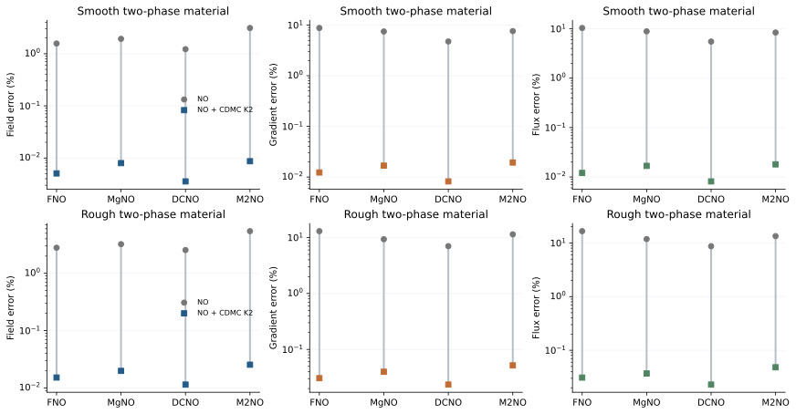
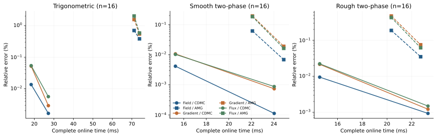
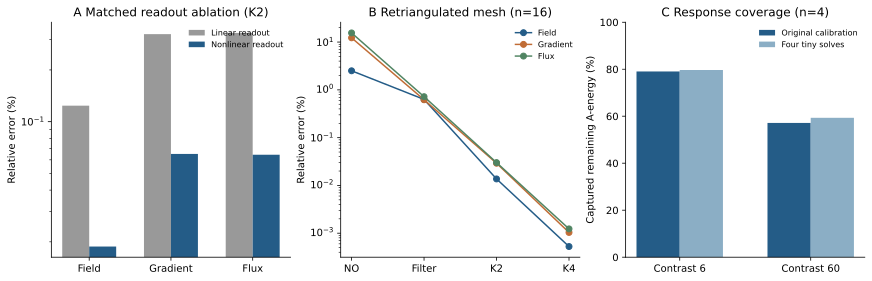

# 学习互补材料响应，实现多尺度椭圆问题的快速精确求解

*Learning complementary material responses for accurate multiscale elliptic solutions*

中文论文初稿｜始稿 2026-10-27｜完整修订 2026-11-04

## 摘要

非均匀介质中的椭圆问题需要同时解析宏观状态和细尺度传输。神经算子能够快速预测主要场结构，但局部导数和材料加权通量的精度仍可能显著落后；对每份新材料重新组织数值求解，又会增加物理校正的在线工作。我们提出互补缺陷多级校正：用固定原网格滤波消除易处理的误差，再由共享多层图网络根据材料、预测状态与剩余缺陷生成紧凑响应空间，通过当前离散方程确定联合修正。非线性空间读出扩展窄网络的有效表示能力，响应与小系统分解跨轮次复用，替代逐材料粗算子层级构建和递归数值传播。一个仅使用48份六尺度材料训练的校正器，冻结后用于三类材料分布、四种预测基底及两种网格分辨率。在257×257网格的32份独立留出材料上，FNO场、导数和通量误差由1.8327%、44.6326%和76.9471%降至两轮校正后的0.01333%、0.04955%和0.05027%，完整在线时间为17.96 ms；四轮达到0.001682%、0.002944%和0.005575%。同一校正器持续改善DCNO与M2NO，并在重新三角剖分的网格上保持精度。匹配消融与材料外推诊断进一步表明，实际剩余响应的覆盖能力决定学习校正的效果。该研究将任务相关的响应表示与原方程校准结合，为材料反复变化的多尺度椭圆计算提供了一条兼顾状态、传输精度和在线成本的途径。误差均以输入一致的同网格有限元参考解为基准。

## 引言

材料的细小变化能够改变系统传输流体、热量或电流的方式。渗透率不同的孔隙介质、热导率跳变的复合材料和非均匀电导介质，都需要计算宏观状态及局部传输响应。描述这些过程的一类基本模型是多尺度椭圆偏微分方程（multiscale elliptic partial differential equations，MsEPDEs）：系数在多种空间长度上变化，通过全域耦合共同决定解。多尺度指材料结构的长度差异，高对比指系数幅值的差异；两者共同出现时，宏观场与细尺度响应的计算尤其具有挑战性。

本文研究正标量系数控制的非均匀扩散，以多尺度Darcy问题为主要实验载体：

$$
-\nabla\cdot\big(a(\xi)\nabla u(\xi)\big)=f(\xi)
\quad\text{in }\Omega,\qquad
u=g\quad\text{on }\partial\Omega,\qquad
0<\alpha\le a(\xi)\le\beta.
$$

其中，$\xi$为空间坐标，$u$为状态，$a$为材料系数，$f$为源项，$g$为已知边界值。在Darcy流中，$u$是压力，$a$包含渗透率与黏度的比例，流量密度为$q=-a\nabla u$。同一方程结构也描述稳态导热和电导，分别以温度和电势作为状态。我们关注的外部问题是：**在材料反复变化的多尺度椭圆计算中，如何以较低完整在线成本，共同获得准确的状态场、空间导数与材料加权通量。**

这一要求超出了主要场形状的恢复。若状态误差包含幅值为$\delta$、波数为$k$的振荡，导数误差的幅值可达到$\delta k$；通量进一步按局部材料系数加权。因此，整体状态相近的预测仍可能给出不同的局部传输结果。HANO已将多尺度细节和导数预测作为核心目标，通过层级注意力及经验$H^1$损失缓解神经算子的谱偏置。[1] 本文沿这一问题继续研究推理阶段的求解分工：保留快速预测已有的结构，同时准确恢复尚未解析的物理响应。

传统数值方法通过解析细尺度、构造材料适应空间和组织多级求解处理非均匀性。有限元将材料信息写入刚度矩阵；多重网格协同使用局部松弛与粗空间修正；广义多尺度有限元（GMsFEM）通过局部谱问题筛选多尺度函数；局部正交分解（LOD）通过细尺度校正构造材料适应表示。[2,3] 这些方法可以获得高精度，并为理解跨尺度耦合提供成熟基础。在材料设计、参数反演和不确定性量化中，系数样本持续变化，相应空间、算子和求解设置可能需要更新。计算经验能否跨材料复用，直接影响重复计算的效率。

神经算子学习材料到解的函数映射，将离线数据转化为快速前向预测。[4] FNO在傅里叶域参数化全局核；面向多尺度问题，HANO使用嵌套注意力，DCNO结合傅里叶全局作用与膨胀卷积局部作用，MgNO以多重网格结构参数化算子，M2NO用预定义多小波空间组织多分辨率交互。[1,5–8] 这些研究从结构和监督两方面改善尺度表示。本文将这些预测器作为可替换的起点，考察预测之后如何通过当前方程继续提高物理输出精度。

数值—神经混合方法提供了多条路径。HINTS交替使用神经逆作用与传统松弛，利用二者的谱互补；残差型误差校正器从近似解导出变分误差问题，再数值求解修正；PINO将数据与物理约束结合，并允许新实例上的继续优化。[9–11] 这些方法说明，在线方程信息能够补充学习预测。物理校正承担多少原始求解工作、需要多少网络作用，以及是否共同改善状态与传输，则取决于具体设计。

更接近本文的是学习数值空间的研究。学习型AMG从矩阵生成延拓关系；DeepONet trunk-basis方法利用预训练主干函数构造子空间校正；GMsFEM-NO学习局部谱子空间，并通过子空间对齐损失减少昂贵的基构造。[12–14] 它们分别学习层间传递、提取预训练表示或近似材料适应空间。本文学习**既定预测与低成本物理滤波之后，当前尚需修正的响应空间**：材料提供相容性，预测状态与缺陷提供任务信息，原方程确定方向之间的耦合和修正幅度。学习容量由此服务于剩余任务，在线物理工作集中在细层稀疏作用和一个小系统上。

这一分工具有可检验的机制依据。对一般慢模态平均覆盖接近的两个空间，可能对实际剩余误差具有明显不同的覆盖；增加输出通道，也可能受窄线性读出的秩限制而无法增加独立方向。我们据此发展互补缺陷多级校正（Complementary Defect Multilevel Correction，CDMC）的响应空间实现：固定原网格滤波、状态条件化的多层图表示、非线性响应字典和当前方程校准构成同一流程。多层结构一次生成空间，固定轮次复用该空间及分解，减少逐材料设置和递归传播。

下文通过三类材料、四种神经基底、成熟数值对照及匹配消融建立证据链。学习空间共同改善场、导数和通量，可冻结迁移至新预测器与网格连接。对比度外推则揭示其下一层困难：当有效材料耦合显著改变时，有限响应空间的覆盖率下降。这将性能、机制与适用条件联系起来，使进一步研究能够围绕可辨识的误差来源展开。

## 结果

### 多尺度材料将状态预测与传输预测区分开来

我们采用三类文献常用材料分布：六尺度三角函数材料、较平滑的两相材料和较粗糙的两相材料。它们共享单位方形上的单位源项和零Dirichlet边界。所有材料先按存储精度确定输入，再用一致P1有限元装配生成参考解，使校正与标签指向同一目标。六尺度材料使用257×257节点，两相材料使用129×129节点。

在六尺度独立留出32份材料上，FNO场误差为1.8327%，导数与通量误差分别达到44.6326%和76.9471%。在粗糙两相材料上，即使FNO训练包含导数监督，三项误差仍为2.7953%、12.9891%和16.5825%。同预算DCNO将三项误差降至2.5486%、7.0181%和8.6805%。这些结果共同支持状态与传输的联合评价。

CDMC先在原网格执行固定物理滤波，再生成响应空间，由真实离散方程联合求出修正，最后后滤波。滤波负责能够直接消除的误差，学习空间负责仍需协同调整的方向。完整流程只在首次预滤波后调用一次图网络，此后复用相同空间。

### 有效响应容量决定紧凑网络的校正能力

空间容量首先受到输出结构约束。若节点隐藏特征为$H\in\mathbb R^{N\times w}$，线性读出$\widetilde Z=HW+\mathbf1b^{\mathsf T}$满足$\operatorname{rank}(\widetilde Z)\le w+1$。当w=16时，128个输出通道仍至多张成17维空间。我们在细节点提升后施加逐元素非线性，解除这一限制，保留窄的共享图主干。

匹配相同初始化、48/12训练验证材料、四轮展开和20轮训练，仅改变线性／非线性读出，在六尺度独立后32份材料上得到下列结果。K表示完整校正轮数。

| 响应读出 | K | 场误差 % | 导数误差 % | 通量误差 % | 完整 ms |
| --- | ---: | ---: | ---: | ---: | ---: |
| 线性128通道 | 2 | 0.123959 | 0.323007 | 0.328370 | 17.84 |
| 非线性128通道 | 2 | **0.018782** | **0.064903** | **0.064208** | 17.21 |
| 线性128通道 | 4 | 0.045282 | 0.112066 | 0.106187 | 26.21 |
| 非线性128通道 | 4 | **0.001778** | **0.003564** | **0.005890** | 25.21 |

非线性读出将两轮场误差降低约6.6倍，四轮降低约25.5倍。独立四材料诊断在相对奇异值阈值$10^{-6}$下观察到数值秩从17至128的变化。收益因此联系到实际独立方向的扩展，而非通道名义数量。

训练目标也影响后期方向。保持相同初始化和四轮训练，仅将三项误差RMS目标改为逐轮、逐输出的对数平均，两轮场／导数／通量由0.01748%／0.05857%／0.05563%降至0.01333%／0.04955%／0.05027%。对数目标使后期小误差持续参与优化；部署仍使用相同流程。

### 一个冻结校正器共同改善四种预测基底

128维校正器仅使用48份六尺度训练材料，参数量3,952。冻结后迁移至两相材料与FNO、MgNO、DCNO、M2NO。两相NO各用256份训练材料、150轮训练及相同场与导数监督。单元格依次报告场／导数／通量误差。

| 材料与网格 | 基底 | n | 纯NO误差 % | CDMC K2误差 % | NO→完整K2 ms |
| --- | --- | ---: | --- | --- | --- |
| 六尺度，257²，独立留出 | FNO | 32 | 1.832715／44.632585／76.947127 | **0.013325／0.049549／0.050267** | 1.49→17.96 |
| 平滑两相，129² | FNO | 32 | 1.569365／8.782999／10.379194 | **0.005057／0.012299／0.012054** | 1.48→15.27 |
| 平滑两相，129² | MgNO | 32 | 1.927526／7.491993／8.876414 | **0.007970／0.016764／0.016763** | 2.53→15.74 |
| 平滑两相，129² | DCNO | 32 | 1.222048／4.755079／5.510362 | **0.003553／0.008187／0.008121** | 2.04→14.64 |
| 平滑两相，129² | M2NO | 32 | 3.114894／7.620884／8.408615 | **0.008663／0.019339／0.017998** | 13.29→25.52 |
| 粗糙两相，129² | FNO | 32 | 2.795345／12.989097／16.582509 | **0.015163／0.030617／0.030957** | 1.45→14.47 |
| 粗糙两相，129² | MgNO | 32 | 3.229320／9.332487／11.816708 | **0.019811／0.039839／0.036929** | 2.45→15.31 |
| 粗糙两相，129² | DCNO | 32 | 2.548576／7.018120／8.680455 | **0.011416／0.023518／0.022920** | 2.08→15.44 |
| 粗糙两相，129² | M2NO | 32 | 5.444252／11.406455／13.400674 | **0.025394／0.051840／0.048176** | 13.20→25.29 |

**表1｜冻结权重的跨材料、跨预测器校正。** 三项均为相对同网格P1参考解的误差百分比，越低越好。时间为RTX4090、batch=1完整在线调用，包含重新预测、逐材料设置与校正。K2为两轮完整校正，小系统每轮原始求解一次。六尺度后32份在结构开发后用于留出检验，两相各32份为各自测试集。

**图1｜准确传输恢复贯穿不同预测架构。** 上、下两行为平滑、粗糙两相材料，各列为一项误差。灰圆为NO，彩色方点为冻结CDMC两轮；连接相同基底、相同32份材料的平均结果。纵轴为误差百分比的对数，源数据与表1一致。

DCNO是新增基底中预测最准确的一种，校正后继续显著改善。M2NO采用官方Darcy结构和共同150轮预算，官方默认配置为500轮。其最佳验证权重在两类材料上的训练误差约0.31%和0.36%，测试为3.11%和5.44%，表明当前256样本条件下存在明显泛化差距。本轮同时检验了强、弱预测起点上的校正能力。

### 学习响应压缩逐材料设置与数值传播工作

成熟数值对照由PyAMG生成经典RS插值与显式Galerkin粗矩阵，再在GPU执行2/2 Jacobi平滑与末层Cholesky求解。两种流程共享FNO初值、同网格方程及每族前16份测试材料。完整时间包含重新预测、细层装配、各自设置和全部更新；同时单列AMG完成设置后的缓存应用时间。

| 材料 | 方法 | 场 % | 导数 % | 通量 % | 完整 ms | 缓存应用 ms |
| --- | --- | ---: | ---: | ---: | ---: | ---: |
| 六尺度，257² | CDMC K2 | **0.013608** | **0.051909** | **0.053975** | **18.36** | — |
| 六尺度，257² | RS-AMG K4 | 0.379748 | 0.541225 | 0.582079 | 73.92 | 6.05 |
| 平滑两相，129² | CDMC K2 | **0.004152** | **0.010668** | **0.010244** | **15.26** | — |
| 平滑两相，129² | RS-AMG K4 | 0.006879 | 0.018951 | 0.016232 | 24.87 | 5.16 |
| 粗糙两相，129² | CDMC K2 | **0.009473** | **0.021511** | **0.022256** | **14.55** | — |
| 粗糙两相，129² | RS-AMG K4 | 0.034984 | 0.074875 | 0.061967 | 22.72 | 4.86 |

**表2｜材料变化时的设置与应用成本。** 每族n=16。完整列均为GPU求解流程同步墙钟，包含RS-AMG在CPU生成层级并传至GPU的成本；缓存列为AMG已设置后的应用。CDMC每次重新生成材料响应及小系统。K描述各自完整更新，物理误差与时间共同给出工作量。

粗糙材料上，CDMC两轮相对RS-AMG四轮将三项误差降低约72.9%、71.3%和64.1%，完整时间降低约36.0%。平滑材料收益较小，六尺度材料的设置与精度差异更大。共享网格图保留一次几何准备，网络生成紧凑方向，真实小系统完成组合，形成材料变化场景下的工作压缩。

**图2｜不同材料上的精度—成本工作点。** 面板依次为六尺度、平滑及粗糙两相，各n=16。颜色为场、导数、通量；实线圆点为CDMC，虚线方点为显式RS-AMG，每线连接K2与K4两个实测点。横轴包括逐材料设置，纵轴为误差百分比的对数。连线显示已测点之间的关系。

材料固定时，AMG复用设置后的应用成本明显下降。高精度CPU AMG-CG端点也显示传统方法能够继续获得很小代数误差：粗糙材料场误差约$4\times10^{-6}\%$，CPU装配、设置与求解合计61.54 ms。该端点刻画高精度数值能力，硬件及计时边界单独报告。

### 小系统去偏提供额外的低成本改善

原校准向Gram矩阵加入固定正则，使相关方向的系数求解稳定，也留下少量幅值偏差。复用同一Cholesky分解，固定两次小系统求解可减少该偏差。它增加一次小型三角求解，全网格算子、图网络及完整校正轮数保持相同。

| 材料／基底，n=16 | 小求解次数 | 场 % | 导数 % | 通量 % | 完整 ms |
| --- | ---: | ---: | ---: | ---: | ---: |
| 平滑／FNO | 1 | 0.004150 | 0.010666 | 0.010248 | 13.65 |
| 平滑／FNO | 2 | **0.003362** | **0.009188** | **0.008857** | 13.86 |
| 粗糙／FNO | 1 | 0.009491 | 0.021515 | 0.022251 | 14.21 |
| 粗糙／FNO | 2 | **0.007866** | **0.018661** | **0.019103** | 14.34 |
| 粗糙／DCNO | 1 | 0.008177 | 0.018078 | 0.018361 | 14.49 |
| 粗糙／DCNO | 2 | **0.007024** | **0.016004** | **0.016180** | 14.55 |

**表3｜固定两轮校正中的小系统去偏。** 同批材料、同权重、同一空闲GPU顺序计时，一次预热后五次同步取中位数。小求解次数与全局K独立。表1、2保留原单次校准结果，本表单独评价两次小求解。

三类材料与FNO、DCNO、M2NO的七个已测组合中，两次小求解均降低平均场、导数及通量误差。这是校准的轻量完善，其作用与学习空间的覆盖能力分别检验。

### 同一响应生成机制迁移到新的网格连接

将129²网格内部节点随机移动至多0.3个单元宽度，重新Delaunay剖分。域仍为单位方形，材料节点值随节点移动，在新网格重算P1参考。规则FNO预测经显式双线性观测形成新网格初值；冻结图校正器直接运行，谱界从当前矩阵计算。

| 方法，n=16 | 场 % | 导数 % | 通量 % | 完整 ms |
| --- | ---: | ---: | ---: | ---: |
| 插值后的FNO | 2.508397 | 12.283468 | 15.558243 | 1.46 |
| 仅物理滤波，两轮匹配工作量 | 0.630813 | 0.620831 | 0.720503 | 10.08 |
| CDMC K2 | **0.013683** | **0.029146** | **0.030070** | 13.77 |
| CDMC K4 | **0.000527** | **0.001038** | **0.001233** | 22.21 |

**表4｜重新剖分网格上的冻结迁移。** 一张新网格，粗糙材料前16份。完整时间包含NO及插值。共享网格计划1.336 s，跨材料复用并单列。实验改变节点和连接，检验校正器的网格迁移；基底FNO在原规则网格预测。

### 材料外推将主要困难定位到响应覆盖

保持粗糙两相材料的相分布和网格，将低相2降至0.2，高相维持12，对比度由6升至60。NO与校正器均冻结，NO接收新的真实系数场。相结构不变，但有效材料耦合强度发生变化。

| 方法，n=16 | 场 % | 导数 % | 通量 % | 完整 ms |
| --- | ---: | ---: | ---: | ---: |
| FNO | 69.148907 | 81.371099 | 136.525155 | 1.42 |
| 仅物理滤波，两轮匹配工作量 | 8.207784 | 8.616136 | 13.121286 | 10.11 |
| CDMC K2 | 1.685196 | 2.550912 | 2.439847 | 13.98 |
| CDMC K2，两次小求解 | 1.535100 | 2.336755 | 2.190134 | 14.05 |
| CDMC K4 | **0.425186** | **0.622635** | **0.445934** | 22.38 |

**表5｜同相结构的材料对比度外推。** 16份材料与原粗糙组配对，外推组重算一致P1参考，指标与时间定义同前。

四份配对材料的离线诊断中，NO场误差由2.864%升至65.995%。即使借助真值拟合最佳单一幅值，外推场误差仍为46.360%，说明存在明显空间形状偏差。预滤波后，字典一次校准捕获的实际剩余能量由79.06%降至57.15%；增加至四次小求解只提高到59.34%。主要缺口位于空间覆盖，提高系数求解精度提供有限补充。

**图3｜表示能力、迁移与剩余困难。** A，相同初始化与训练协议下的128通道读出消融，K2，六尺度留出n=32。B，新三角网格不同阶段的三项误差，n=16。C，对比度6／60的四份配对材料捕获的预滤波后A能量比例，一次与四次小求解复用同空间。C使用真值进行离线诊断，部署使用当前方程残差。

## 讨论

本研究把多尺度椭圆计算中的学习目标放在剩余材料响应的表示上。数值滤波处理可便宜消除的误差，网络生成协同方向，当前方程确定方向幅度与耦合。通过这一分工，快速预测与细尺度物理求解成为连续流程，场、导数和通量在同一离散目标下共同改善。

这一结果澄清了学习空间的两种评价。一般慢模态覆盖有助于理解收敛，实际任务覆盖决定有限工作下的改进。早期等维原型中，学习与固定空间对最慢16模态平均覆盖均约67%，对同组实际误差覆盖却为77.70%和8.56%。这一机制观察推动状态条件化设计；当前匹配读出消融进一步说明，空间容量应由独立响应能力衡量。

与HINTS、学习型AMG、trunk-basis预条件相比，本文将材料、当前状态和滤波后缺陷共同用于响应生成，在完整流程中监督三项物理输出。[9,12,13] 与学习GMsFEM局部谱空间相比，目标是满足给定预测之后的实际剩余任务，训练使用解与物理输出，在线组合直接作用于原细层方程。[14] 任务选择性有助于压缩工作，也使材料和载荷覆盖成为重要条件。方法位置由此明确：学习选择有限表示，数值完成当前方程中的组合。

成本改善来自工作替代与复用。流程保留精确细层装配、稀疏作用与小系统校准，多层图一次生成空间，省去逐材料粗算子层级和递归数值V-cycle。固定材料、多右端项时，成熟数值方法同样可以摊销设置；材料持续变化时，共享几何与学习响应提供另一种复用方式。完整设置与缓存应用分别刻画这些场景。

物理精度还包含两个层次。本文小误差相对输入一致的同网格有限元目标；独立细化审计中，原六尺度257²解与513²细解限制值相差约9%。细尺度材料的空间分辨率仍决定连续问题精度。高精度代数校正准确求解既定离散物理，进一步逼近连续解需要与独立空间收敛评价衔接。

材料外推给出具体的深化方向。相结构保持相同，耦合强度变化已能降低空间对实际误差的覆盖。响应表示需要同时感知几何连接、材料连接强度与任务所需变化。扩大这种覆盖有望减少额外轮次；提高小系统求解精度或重复相同空间的收益会逐渐受限。围绕这一机制研究材料结构与载荷，可以保持相同椭圆方程内核。

## 方法

### 连续模型、离散目标与物理输出

令$\Omega\subset\mathbb R^2$有界，$0<\alpha\le a\le\beta$。取满足边界的提升$u_g$，令$u=u_g+w$，$w\in H_0^1(\Omega)$。将方程乘任意$v\in H_0^1(\Omega)$并分部积分，得到

$$
\int_\Omega a\nabla w\cdot\nabla v\,d\xi
=\int_\Omega fv\,d\xi-\int_\Omega a\nabla u_g\cdot\nabla v\,d\xi.
$$

在三角网格取P1基$\phi_i$，令$w_h=\sum_i x_i\phi_i$，逐一以基函数测试并消去Dirichlet自由度，得到

$$
A_{ij}=\int_\Omega a\nabla\phi_i\cdot\nabla\phi_j,\qquad
b_i=\int_\Omega f\phi_i-\int_\Omega a\nabla u_g\cdot\nabla\phi_i,\qquad
Ax^\star=b.
$$

正材料与边界约束使$A=A^{\mathsf T}\succ0$。NO经边界处理和自由度限制形成$x^{(0)}$。对当前x，定义$e=x^\star-x$和$r=b-Ax$，由参考方程直接得到$Ae=r$。

完成固定K轮后，恢复$u_h=u_g+\sum_i x_i^{(K)}\phi_i$。每个三角形T上梯度为常量，通量为$q_h|_T=-a_T\nabla u_h|_T$。相同$a_T$用于装配、参考解与输出。

### 网格准备与逐材料装配

固定网格预先生成单元几何、边界自由度映射、CSR散射位置，以及单位材料参考图层级和传递。P1基梯度为单元常量，对线性节点材料，单元平均$a_T$为三节点均值，故

$$
A_{ij}^T=|T|a_T\nabla\phi_i|_T\cdot\nabla\phi_j|_T.
$$

逐材料在线计算$a_T$，按编译散射装配当前A、b及对角D。参考图层级跨材料复用，物理校正始终使用当前细层A。网格准备与逐材料设置分别计量。

### 当前矩阵定义的物理滤波

设$D=\operatorname{diag}(A)$。$D^{-1}A$与对称正定的$D^{-1/2}AD^{-1/2}$相似。采用Gershgorin行界

$$
\lambda_U=(1+10^{-6})\max_i\frac{\sum_j|A_{ij}|}{A_{ii}}
$$

给出统一谱上界。直角三角形标量扩散上接近2，新网格上随当前矩阵变化。

记$\mathcal S_m(x;A,b)$为固定m步Chebyshev半迭代。给定截止值$\lambda_c$，令$d=(\lambda_U+\lambda_c)/2$、$c=(\lambda_U-\lambda_c)/2$，误差多项式为

$$
S_m=p_m(D^{-1}A),\qquad
p_m(\lambda)=\frac{T_m((d-\lambda)/c)}{T_m(d/c)}.
$$

计算从$r_0=b-Ax$开始，令$\delta_0=D^{-1}r_0/d$、$x_1=x+\delta_0$、$\rho_0=c/d$。后续递推

$$
\rho_j=(2d/c-\rho_{j-1})^{-1},\qquad
\delta_j=\frac{2\rho_j}{c}D^{-1}(b-Ax_j)+\rho_j\rho_{j-1}\delta_{j-1},\qquad
x_{j+1}=x_j+\delta_j.
$$

它使用细层稀疏作用、对角缩放和向量更新。每轮预滤波m=64、$\lambda_c=0.0005\lambda_U$，后滤波m=8、$\lambda_c=0.025\lambda_U$。截止值规定压低的谱区间。对$0<\lambda\le\lambda_U$，$|p_m(\lambda)|\le1$，精确算术下滤波不增加A能量误差。

### 材料与状态的统一输入

首次预滤波得到$\bar x$，计算$r=b-A\bar x$。每个自由节点的七个特征为：$\log a_i/\log12$、相对中位数的对角对数、两个坐标、相对中位数的节点质量对数，以及

$$
\widehat x_i=\bar x_i/\operatorname{RMS}(\bar x),\qquad
\widehat d_i=(D^{-1}r)_i/\operatorname{RMS}(D^{-1}r).
$$

RMS分母以$10^{-12}$保护，固定材料尺度在所有数据族共用。材料和对角描述物理，状态与对角残差提供空间形状，修正幅度由后续真实方程确定。

### 共享多层图网络

令$P_\ell$将第$\ell+1$层提升到第$\ell$层。下采样$R_\ell^+$由$|P_\ell|^{\mathsf T}$按行归一化得到正权平均。邻接$\mathcal G_\ell$取单位材料参考矩阵的非对角绝对值并按行归一化。它们在材料变化时复用。

先递推$F_{\ell+1}=R_\ell^+F_\ell$获得七维输入的各层表示，隐藏宽度w=16。一个图消息块为

$$
\mathcal B_\ell(H)=H+\operatorname{GELU}\!\left[
\operatorname{LN}(HW_s+\mathcal G_\ell HW_n+b_s)\right].
$$

其中$HW_s$处理节点自身，$\mathcal G_\ell HW_n$聚合邻居，LayerNorm归一化通道，GELU引入非线性，残差保留原特征。从第一粗图$\ell=1$开始下行：

$$
O_\ell=\operatorname{GELU}(F_\ell W_{\rm in}+b_{\rm in}),\qquad
H_1=\mathcal B_1^\downarrow(O_1),\qquad
H_\ell=\mathcal B_\ell^\downarrow(O_\ell+R_{\ell-1}^+H_{\ell-1}).
$$

下行扩大材料和缺陷的感受范围。设最粗层为L，上行以$U_L=H_L$开始：

$$
U_\ell=\mathcal B_\ell^\uparrow\!\left[
\operatorname{GELU}\!\left([H_\ell,P_\ell U_{\ell+1}]W_{\rm merge}+b_{\rm merge}\right)
\right].
$$

拼接保留本层细节与粗层上下文。下行各层共享一套消息参数，上行共享另一套；输入、融合、输出映射同样跨层复用。输出128通道，先提升回自由节点，再非线性读出：

$$
\widetilde Z=\tanh\!\left[P_0\left(U_1W_{\rm out}+\mathbf1b_{\rm out}^{\mathsf T}\right)\right].
$$

网络共3,952参数，参数量不随节点和层数增长。层级传播用于特征与方向生成，数值校正使用细层方程和生成的响应空间。

### 方向整形与能量归一化

对输出执行两次当前材料Jacobi整形：

$$
\widetilde Z^{j+1}=\widetilde Z^j-\frac4{3\lambda_U}D^{-1}A\widetilde Z^j,
\qquad j=0,1.
$$

当$\lambda_U\approx2$时对应$2/3$权重。固定整形减少方向粗糙能量。随后每列按$\sqrt{z_j^{\mathsf T}Az_j}$归一化，分母平方以下界$10^{-20}$保护，得到Z。一个非线性字典提供全部列空间，主配置r=128。

### 原方程校准与能量性质

定义$\mathcal E(x)=\frac12x^{\mathsf T}Ax-b^{\mathsf T}x$。在当前x上求解

$$
c=\arg\min_y\left[\mathcal E(x+Zy)+\frac\eta2\|y\|_2^2\right],\qquad\eta=10^{-5}.
$$

展开关于y的项并求导，得到

$$
G=Z^{\mathsf T}AZ,\qquad H=G+\eta I,\qquad
Hc=Z^{\mathsf T}(b-Ax),\qquad x^+=x+Zc.
$$

Gram以双精度形成、对称化后作Cholesky分解。网络提供方向，A提供方向间耦合及幅度。由$e=x^\star-x$和$Hc=Z^{\mathsf T}Ae$逐步可得

$$
\begin{aligned}
\|e-Zc\|_A^2
&=\|e\|_A^2-2c^{\mathsf T}Z^{\mathsf T}Ae+c^{\mathsf T}Gc\\
&=\|e\|_A^2-c^{\mathsf T}Gc-2\eta\|c\|_2^2.
\end{aligned}
$$

因此精确算术下能量不增；无正则时对应A正交投影。该小型Galerkin校准具有经典变分基础，学习改变所选空间及其任务适应性。

固定小系统去偏令$q=Z^{\mathsf T}r$，复用H分解：

$$
d_0=H^{-1}q,\qquad d_{j+1}=H^{-1}(\eta d_j),\qquad
c_t=\sum_{j=0}^{t-1}d_j.
$$

t=1为原校准，t=2多一次三角求解。对G特征值$\lambda>0$，相对无正则投影的增益为

$$
g_t(\lambda)=\lambda\sum_{j=0}^{t-1}\frac{\eta^j}{(\lambda+\eta)^{j+1}}
=1-\left(\frac\eta{\lambda+\eta}\right)^t\in[0,1].
$$

给定空间内误差的剩余幅值随t减小，正交补保持不变，因此继续减少空间内能量。数值核另在20个非M矩阵SPD系统上完成验证。

### 固定轮次执行与空间复用

NO生成$x^{(0)}$后，构建当前A、b、D并预滤波，设置Z、AZ、G及H分解。第一轮校准后后滤波；后续每轮重新预滤波、计算残差、校准与后滤波，复用同Z及分解。最终恢复边界和物理输出。

固定Z、无正则时，令$\Pi_A=Z(Z^{\mathsf T}AZ)^\dagger Z^{\mathsf T}A$，一轮传播为

$$
e^{(k+1)}=S_{\rm post}(I-\Pi_A)S_{\rm pre}e^{(k)}.
$$

预滤波改变剩余误差分布，投影处理所覆盖协同方向，后滤波处理投影后的局部分量。部署K固定为1、2或4；主表K2，小系统t单独设置。

### 任务覆盖与物理误差

给定A和候选空间，记$y=A^{1/2}e$、$Q=A^{1/2}Z$，则投影后能量为$\|(I-\Pi_Q)y\|_2^2$，$\Pi_Q=Q(Q^{\mathsf T}Q)^\dagger Q^{\mathsf T}$。固定该空间，对一族初值或载荷取期望，令$C=\mathbb E[yy^{\mathsf T}]$，有

$$
\mathbb E\|(I-\Pi_Q)y\|_2^2
=\operatorname{tr}\big[(I-\Pi_Q)C\big].
$$

实际误差权重影响空间价值；均匀测量一组模态与最小化实际任务是不同目标。状态条件化对这种任务差异建模。

正材料同时给出

$$
\alpha\|\nabla e_h\|_{L^2}^2\le\|e_h\|_a^2\le\beta\|\nabla e_h\|_{L^2}^2,\qquad
\alpha\|e_h\|_a^2\le\|a\nabla e_h\|_{L^2}^2\le\beta\|e_h\|_a^2.
$$

再由Poincaré不等式有$\|e_h\|_{L^2}\le C_P\|e_h\|_a/\sqrt\alpha$。能量为物理误差提供控制，界中常数受材料对比度影响；训练和评价因此直接保留三项输出。

### 训练与选模

冻结NO，使用其实际预测经预滤波后的状态。以同网格参考定义

$$
E_u=\frac{\|u_h-u_h^\star\|_M}{\|u_h^\star\|_M},\qquad
E_g=\frac{\|\nabla u_h-\nabla u_h^\star\|_{L^2}}{\|\nabla u_h^\star\|_{L^2}},\qquad
E_q=\frac{\|a_T(\nabla u_h-\nabla u_h^\star)\|_{L^2}}{\|a_T\nabla u_h^\star\|_{L^2}}.
$$

M为P1节点集总质量矩阵，即以各节点所邻单元面积的三分之一累加形成对角权重。导数与通量使用单元面积精确积分。高精度训练展开K=4轮，以各轮、各输出相对误差的对数平均监督：

$$
\mathcal L(\theta)=\frac1{3K}\sum_{k=1}^K\sum_{j\in\{u,g,q\}}
\log\max(E_j^{(k)},10^{-6}).
$$

地板仅保护训练对数。梯度通过空间生成、整形、分解和完整更新反向传播，验证集按相同目标选模。

当前权重继承已有共享图表示，在相同48训练／12验证材料上依次完成64维字典30轮、128维扩展20轮、四轮平衡目标20轮。三阶段记录用时约199、142和241秒，计为本轮增量训练，NO及继承权重早期训练另有记录。AdamW初始学习率$3\times10^{-4}$、权重衰减$10^{-5}$、余弦衰减、梯度范数上限2。每科学配置训练一次，验证选模。六尺度前32测试材料用于开发，后32用于留出检验；正文主表选后32。两相各32份为新分布测试。

### 材料与参考解

三类数据共享物理和P1接口。六尺度在原坐标$(\xi,\zeta)\in(-1,1)^2$上定义

$$
a(\xi,\zeta)=\prod_{k=0}^5
\left[1+\tfrac12\cos\big(\pi\omega_k(\xi+\zeta)\big)\right]
\left[1+\tfrac12\sin\big(\pi\omega_k(\zeta-3\xi)\big)\right],\qquad
\omega_k\sim U(1,1.5)2^k.
$$

映射单位方形后重算标签，512/64/64训练／验证／测试材料，257²节点、131,072三角形、65,025自由未知量，测试对比度约$10^4$至$6.45\times10^4$。

两相由Neumann余弦基随机场符号阈值生成，协方差为$(-\Delta+cI)^{-2}$的DCT近似并去掉常数模态。平滑c=9、相值3/12，粗糙c=20、相值2/12；各256/32/32材料，129²节点。三类分布借鉴HANO，标签以一致P1流程再生成。[1]

坐标与材料先按存储精度确定，再双精度装配和直接参考求解，最后存标签；原六尺度参考相对残差约$10^{-11}$。校正的A、b与标签表示同一方程。独立细化另评价空间离散误差。

### 基线与公平条件

六尺度FNO为四个谱／逐点混合块，宽32、模态16、padding9，512样本训练150轮。两相FNO、MgNO、DCNO、M2NO各150轮、batch8，相同训练归一化及场相对L2加0.1倍导数相对误差监督，各按验证选权重。

MgNO取固定官方源码模型定义；DCNO取固定公开提交七个模型类，AST核验一致，宽32、模态12、三个傅里叶—膨胀卷积单元及公开解码器；M2NO保留官方模块，Darcy配置k4/c2/五层/[3,3,2,2,1]/LayerNorm，129输入填充至160再裁回。M2NO本轮共同150轮，官方默认500轮。固定源码提交随实验保存。

数值对照包括经典RS-AMG、聚合AMG、显式GPU AMG及高精度AMG-CG端点。表2为经典RS传递、GPU 2/2 Jacobi、末层Cholesky。滤波对照使用相同A及匹配总滤波次数；结构消融匹配初始化、材料、预算及通道；目标消融从同128维权重继续训练。NO与其加校正版本共用相同基底权重。

### 迁移、诊断与计量

网格实验在同一扰动新网格上测试16材料，16,641节点、32,768三角形，重算参考，GPU双线性观测计入时间。对比度外推保留相结构，改相值重算解。均冻结NO及校正权重。

捕获率为校准前后A能量误差平方的相对减少。真值辅助调幅、能量覆盖和数值秩均离线诊断。早期慢模态实验在4材料上求$Av_i=\lambda_iDv_i$，比较最慢16模态及同组实际误差覆盖，其原型权重与当前主表分别标明。

误差为材料算术平均。计时RTX4090、batch=1、输入在GPU，一次预热后三次同步墙钟中位数，再跨材料平均；去偏隔离计时五次。完整时间含网络、细层装配、特征、字典、分解及更新；读取、指标和共享网格计划单列。

257²网格计划两次主评测为8.66和10.04秒，新129²非规则网格1.336秒，均由同网格多材料摊销。四样本阶段同步诊断中，NO、装配、预滤波、特征、图字典、空间分解、其余校准滤波分别约2.20、0.75、4.26、0.43、3.22、3.50、5.28 ms。阶段同步改变调度，完整延迟按整段计时。

### 复杂度与复用

设自由度N、细层非零元s、字典维r、每轮总滤波次数m。AZ为$O(sr)$，Gram构造$O(Nr^2)$，分解$O(r^3)$；K轮更新$O(K(ms+Nr+tr^2))$。图网络为共享层级稀疏消息传播，响应存储$O(Nr)$。

稀疏连接且r、m、K固定时，主要细层工作随N近线性。r增大提升Gram成本和存储，故紧凑有效空间直接影响效率。与理想线性复杂度MG的差异体现在材料设置、常数和复用条件，表2及图2评价共同形成的工作点。

## 数据与代码可获得性

当前入口为[study.py](../experiments/multiscale_elliptic_v1/refinement/study.py)，数值核为[core.py](../experiments/multiscale_elliptic_v1/refinement/core.py)，结构与命令见[统一方法文档](../experiments/multiscale_elliptic_v1/refinement/README.md)。数据入口为[generate_suite.py](../../baselines/data/multiscale_elliptic_v1/generate_suite.py)。源数据、权重、日志及固定基线源码按运行目录保存。

| 正文证据 | 来源 |
| --- | --- |
| 六尺度留出、FNO/MgNO迁移、成熟数值对照 | [主报告](../experiments/multiscale_elliptic_v1/results/refinement_20261103/RESULTS.md)、[CSV](../experiments/multiscale_elliptic_v1/results/refinement_20261103/SUMMARY.csv) |
| DCNO/M2NO、消融、去偏、网格与对比度 | [补充报告](../experiments/multiscale_elliptic_v1/results/extension_20261103/RESULTS.md)、[CSV](../experiments/multiscale_elliptic_v1/results/extension_20261103/SUMMARY.csv) |
| 权重与文件核查 | [主审计](../experiments/multiscale_elliptic_v1/results/refinement_20261103/AUDIT.json)、[补充审计](../experiments/multiscale_elliptic_v1/results/extension_20261103/AUDIT.json) |
| 图1—3重绘与来源 | [绘图程序](../experiments/multiscale_elliptic_v1/refinement/manuscript_figures.py)、[图源清单](assets/multiscale_elliptic_20261104/SOURCES.json) |
| 前期任务选择性与动态条件 | [机制研究报告](../experiments/multiscale_elliptic_v1/DEPTH_STUDY_20261103.md) |

图表由已保存实验生成，原始运行保留不覆盖。修订前72/144维稿保存在[历史归档](archive/CDMC_NATURE_MANUSCRIPT_BEFORE_REFINEMENT_20261104.md)。

## 参考文献

1. Liu, X., Xu, B., Cao, S. & Zhang, L. Mitigating spectral bias for the multiscale operator learning. *JCP* (2024), 112944. [原文](https://arxiv.org/abs/2210.10890)；[正式论文](https://doi.org/10.1016/j.jcp.2024.112944)。
2. Efendiev, Y., Galvis, J. & Hou, T. Y. Generalized Multiscale Finite Element Methods (GMsFEM). *JCP* (2013). [原文](https://arxiv.org/abs/1301.2866)；[正式论文](https://doi.org/10.1016/j.jcp.2013.04.045)。
3. Målqvist, A. & Peterseim, D. Localization of elliptic multiscale problems. *Mathematics of Computation* **83**, 2583–2603 (2014). [正式论文](https://doi.org/10.1090/S0025-5718-2014-02868-8)。
4. Kovachki, N. et al. Neural Operator: Learning Maps Between Function Spaces With Applications to PDEs. *JMLR* **24**, 89 (2023). [正式论文](https://jmlr.org/papers/v24/21-1524.html)。
5. Li, Z. et al. Fourier Neural Operator for Parametric Partial Differential Equations. *ICLR* (2021). [原文](https://arxiv.org/abs/2010.08895)。
6. Xu, B., Liu, X. & Zhang, L. Dilated convolution neural operator for multiscale partial differential equations. 作者稿 (2024). [原文](https://arxiv.org/abs/2408.00775)；[采用的公开实现](https://github.com/zhuhanqing/DCNO-ICLR2024)。
7. He, J., Liu, X. & Xu, J. MgNO: Efficient Parameterization of Linear Operators via Multigrid. *ICLR* (2024). [原文](https://arxiv.org/abs/2310.19809)；[官方代码](https://github.com/xlliu2017/MgNO)。
8. Li, Z., Lai, Z., Zhang, X. & Wang, W. M2NO: An Efficient Multi-Resolution Operator Framework for Dynamic Multi-Scale PDE Solvers. *KDD* (2026). [原文](https://arxiv.org/abs/2406.04822)；[官方代码](https://github.com/lizhihao2022/M2NO)。
9. Zhang, E. et al. Blending neural operators and relaxation methods in PDE numerical solvers. *Nature Machine Intelligence* **6**, 1303–1313 (2024). [正式论文](https://www.nature.com/articles/s42256-024-00910-x)；[作者稿](https://arxiv.org/abs/2208.13273)。
10. Jha, P. K. Residual-based error corrector operator to enhance accuracy and reliability of neural operator surrogates of nonlinear variational boundary-value problems. *CMAME* **419**, 116595 (2024). [正式论文](https://doi.org/10.1016/j.cma.2023.116595)；[作者稿](https://arxiv.org/abs/2306.12047)。
11. Li, Z. et al. Physics-Informed Neural Operator for Learning Partial Differential Equations. 作者稿. [原文](https://arxiv.org/abs/2111.03794)。
12. Luz, I., Galun, M., Maron, H., Basri, R. & Yavneh, I. Learning Algebraic Multigrid Using Graph Neural Networks. *ICML*, PMLR **119**, 6489–6499 (2020). [正式论文](https://proceedings.mlr.press/v119/luz20a.html)。
13. Kopaničáková, A. & Karniadakis, G. E. DeepONet Based Preconditioning Strategies for Solving Parametric Linear Systems of Equations. *SIAM Journal on Scientific Computing* **47** (2025). [正式论文](https://doi.org/10.1137/24M162861X)；[作者稿](https://arxiv.org/abs/2401.02016)。
14. Rudikov, A. et al. Locally Subspace-Informed Neural Operators for Efficient Multiscale PDE Solving. 作者稿，2026年修订版. [全文](https://arxiv.org/html/2505.16030v2)。

## 补充说明：任务选择性的前期机制证据

以下使用早期72维响应原型，说明设计形成的机制依据。当前128维主结果和匹配结构消融分别见表1与结果第二节。

| 检验 | 条件与观察 | 启示 |
| --- | --- | --- |
| 物理阶段互补 | 8验证材料：FNO导数／通量45.38%／77.56%，预滤波后4.36%／5.24%，完整一轮0.668%／0.716% | 滤波与响应处理不同剩余分量 |
| 条件作用 | 8验证材料：正确条件捕获77.37%剩余能量，错配材料及状态10.32% | 当前条件影响方向选择 |
| 任务与慢模态 | 同4材料：学习／固定空间慢模态平均67.12%／67.43%，实际误差77.70%／8.56% | 任务权重决定空间价值 |
| 动态条件匹配训练 | 同48/12材料、20轮：仅材料条件K2场0.15032%，完整条件0.03952% | 状态与缺陷提供训练可利用信息 |

空间富集、Galerkin投影和谱互补具有成熟基础。本研究通过前期机制、当前匹配消融、冻结迁移和完整成本对照，具体研究学习如何选择剩余材料响应，并减少获得准确物理输出所需的在线工作。
