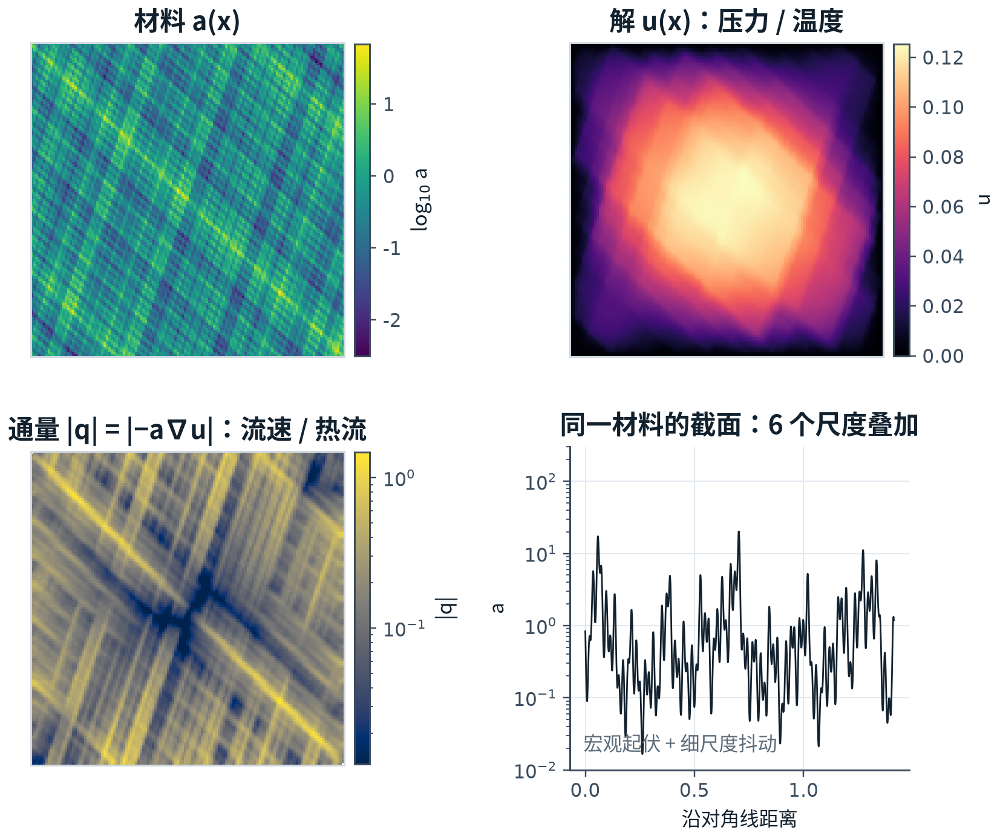
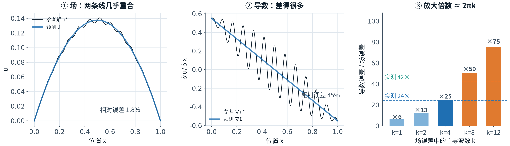
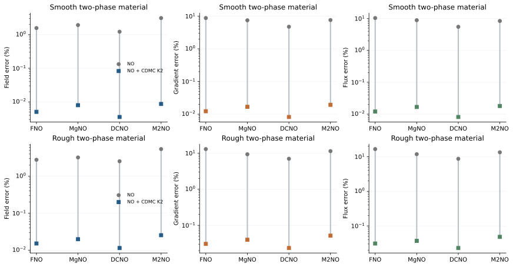
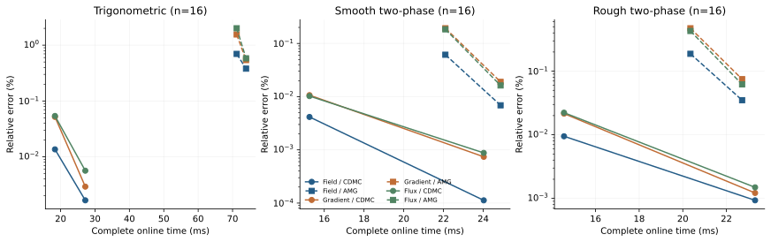
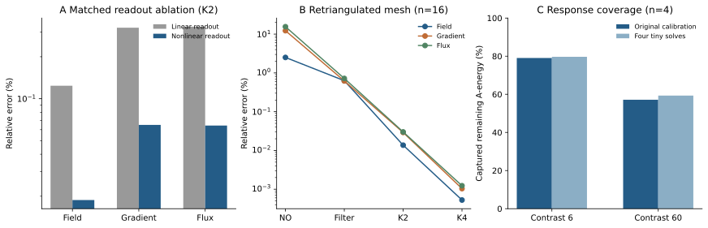

# 学习互补材料响应，实现多尺度椭圆问题的快速精确求解

**汇报稿**｜由论文初稿 `CDMC_NATURE_MANUSCRIPT_EXTENDED_20261027.md` 整理｜2026-11-05

| 项目 | 内容 |
| --- | --- |
| 汇报时长 | 正文约 30 分钟，提问约 10 分钟 |
| 汇报主线 | 问题定义 → 误差结构 → 方法分工 → 实验证据 → 适用边界 |
| 一句话结论 | 在多尺度、高对比材料中，把学习用于选择"剩余响应的方向"、把计算用于确定"方向的幅度"，可以在冻结迁移的条件下把状态、导数与通量误差同时降到 10⁻² % 量级，完整在线时间 17.96 ms。 |
| 证据范围 | 正标量系数、稳态、线性、二维椭圆问题；三类材料、四类预测器、两种网格分辨率 |

> **讲稿提示（开场）**：本次汇报的内容来自已经完成的论文初稿与实验。汇报不追求覆盖全部细节，而是按"问题—证据—方法—边界"的顺序，说明三件事：为什么状态算得准不等于传输算得准；我们用什么计算分工解决它；现有证据支持到什么程度。

---

## 摘要（开场 60 秒）

非均匀介质中的椭圆问题需要同时解析宏观状态与细尺度传输。神经算子能够快速预测主要场结构，但局部导数和材料加权通量的精度仍可能显著落后；对每份新材料重新组织数值求解，又会增加物理校正的在线工作。本文提出互补缺陷多级校正：用固定原网格滤波消除易处理的误差，再由共享多层图网络根据材料、预测状态与剩余缺陷生成紧凑响应空间，通过当前离散方程确定联合修正。非线性空间读出扩展窄网络的有效表示能力，响应与小系统分解跨轮次复用，替代逐材料粗算子层级构建和递归数值传播。一个仅使用 48 份六尺度材料训练的校正器，冻结后用于三类材料分布、四种预测基底及两种网格分辨率。在 257×257 网格的 32 份独立留出材料上，FNO 的状态、导数和通量误差由 1.8327%、44.6326%、76.9471% 降至两轮校正后的 0.01333%、0.04955%、0.05027%，完整在线时间 17.96 ms；四轮达到 0.001682%、0.002944%、0.005575%。同一校正器持续改善 DCNO 与 M2NO，并在重新三角剖分的网格上保持精度。匹配消融与材料外推诊断进一步表明，实际剩余响应的覆盖能力决定学习校正的效果。误差均以输入一致的同网格有限元参考解为基准。

> **讲稿提示**：这段是论文摘要的汇报版。若时间允许，按"问题—方法—结果—机制"四句讲；若时间紧，只讲三个数字与 17.96 ms。

---

## 0 汇报提纲

| 部分 | 内容 | 对应论文位置 | 建议时间 |
| --- | --- | --- | --- |
| 1 | 研究问题与物理背景：材料、状态、通量；三项误差 | 引言前半 | 6 min |
| 2 | 相关工作与方法定位：三条路线与本文位置 | 引言后半 | 4 min |
| 3 | 主要结果：可分性、容量、跨预测器、成本、去偏、迁移、外推 | 结果 | 12 min |
| 4 | 讨论：机制解释、成本、精度层次、局限 | 讨论 | 4 min |
| 5 | 方法：离散、滤波、字典、校准、复用、训练与实验设置 | 方法 | 4 min（按需展开） |
| 6 | 结论与问答 | — | 2 min |

> **与初稿的对应关系**：本稿章节与论文初稿一一对应（引言 → 第 1、2 节；结果 → 第 3 节；讨论 → 第 4 节；方法 → 第 5 节）。图 1、图 2 为新增的物理直观图；图 3、图 4、图 5 为论文原图，未重绘。

> **讲稿提示**：方法与结果在论文中的顺序是"结果在前、方法在后"。汇报保持这一顺序，但在进入结果之前先用三句话说明方法，避免听众在结果部分失去参照。

**方法三句话**：固定原网格滤波抑制局部高频误差；共享多层图根据材料与当前残差一次生成紧凑响应空间；当前离散方程在该空间内求解修正幅度，空间与分解在固定轮次间复用。

---

# 1 研究问题与物理背景

## 1.1 物理对象：材料、状态与通量

材料的细小变化会改变系统传输流体、热量或电流的方式。渗透率不同的孔隙介质、热导率跳变的复合材料、非均匀电导介质，都需要同时计算宏观状态与局部传输响应。描述这类过程的基本模型是多尺度椭圆偏微分方程：

$$
-\nabla\cdot\big(a(x)\nabla u(x)\big)=f(x)
\quad\text{in }\Omega,\qquad
u=g\quad\text{on }\partial\Omega,\qquad
0<\alpha\le a(x)\le\beta .
$$

其中 $a$ 为正标量材料系数，$u$ 为状态，$f$ 为源项，$g$ 为边界值。在 Darcy 流中，$u$ 是压力，$a$ 包含渗透率与黏度的比例，通量为

$$
q=-a\nabla u .
$$

同一方程结构也描述稳态导热与电导：$u$ 为温度或电势，$a$ 为热导率或电导率，$q$ 为热流或电流密度。

本文实验使用的六尺度材料由六个频率叠加而成，频率按 $2^k$ 递增：

$$
a(\xi,\zeta)=\prod_{k=0}^{5}
\left[1+\tfrac12\cos\big(\pi\omega_k(\xi+\zeta)\big)\right]
\left[1+\tfrac12\sin\big(\pi\omega_k(\zeta-3\xi)\big)\right],\qquad
\omega_k\sim U(1,1.5)2^k .
$$

图 1 给出同一材料的四个视图：材料系数、状态、通量模与对角线截面。材料的细结构几乎原样出现在通量中；状态在宏观尺度上平滑。原因直接来自 $q=-a\nabla u$：材料在细尺度上的变化直接进入通量。

**图 1｜材料、状态与通量。** (a) 材料系数（对数色标）；(b) 状态；(c) 通量模（对数色标）；(d) 同一材料的对角线截面。按论文材料定义在 129² 网格上独立 P1 求解，展示物理结构，不用于精度比较。

**本页要点**

- 三类物理问题（Darcy、导热、电导）共享同一方程结构，方法只需实现一次。
- 六尺度材料不存在尺度分离，均匀化类方法的适用前提在此不成立。
- 257² 网格含 65,025 个自由未知量、131,072 个三角形；测试材料对比度约 $10^4$ 至 $6.45\times10^4$。
- 因此本文选择在原细网格上求解，把"每份材料重新组织数值设置"的工作作为压缩对象，而不是压缩细网格离散本身。

> **讲稿提示**：这一页只建立物理对象，不涉及方法。需要强调：工程使用的量是通量而不是状态云图；通量的空间结构由材料细结构决定，这一点决定了后文的评价方式。

## 1.2 为什么必须同时评价状态、导数与通量

本文使用三项相对误差：

$$
E_u=\frac{\|u_h-u_h^\star\|_M}{\|u_h^\star\|_M},\qquad
E_g=\frac{\|\nabla u_h-\nabla u_h^\star\|_{L^2}}{\|\nabla u_h^\star\|_{L^2}},\qquad
E_q=\frac{\|a_T(\nabla u_h-\nabla u_h^\star)\|_{L^2}}{\|a_T\nabla u_h^\star\|_{L^2}} .
$$

三项均相对输入一致的同网格 P1 有限元参考解，$M$ 为 P1 节点集总质量矩阵，导数与通量使用单元面积精确积分。

为什么不能只报告状态误差？若状态误差包含幅值 $\delta$、波数 $k$ 的振荡，导数误差的幅值约为 $\delta k$；通量再按局部材料系数加权。图 2 用一维例子说明这一关系：状态曲线几乎重合（相对误差 1.8%），同一条误差曲线的导数却明显偏离（45%）；放大倍数约为 $2\pi k$，实测的 24 倍与 42 倍分别对应 $k\approx4$ 与 $k\approx7$，与材料主频段一致。

**图 2｜状态精度与传输精度的分离。** (a) 状态曲线；(b) 同一误差的导数；(c) 放大倍数随主导波数的标度关系；虚线为六尺度材料上的实测倍率（导数/状态 24 倍，通量/状态 42 倍）。

**本页要点**

- 状态误差、导数误差、通量误差衡量不同性质的准确性，不能互相替代。
- 在六尺度 257²、32 份独立留出材料上，FNO 的三项误差为 1.8327%、44.6326%、76.9471%。
- 同一结构在 DCNO、M2NO、MgNO 上同样存在；这是此类方法的共同误差结构，不是个别模型调参不足。
- 因此本文把三项输出放在同一训练目标与同一评价框架下处理。

> **讲稿提示**：这一页是全文的问题核心。若听众只记一件事，就是"状态误差 1.8% 时，通量误差可以是 77%"。后面的方法设计都围绕这一点。

## 1.3 核心问题与三个子问题

本文关注的外部问题是：

> **在材料反复变化的多尺度椭圆计算中，如何以较低的完整在线成本，共同获得准确的状态场、空间导数与材料加权通量？**

这一问题拆成三个可检验的子问题：

| 子问题 | 具体内容 | 检验方式 |
| --- | --- | --- |
| ① 表示 | 有限的在线工作应当表示什么：完整解、误差场，还是剩余响应的方向空间？ | 匹配读出消融、字典秩诊断 |
| ② 覆盖 | 紧凑空间为何能够覆盖当前材料与当前预测真正缺失的方向？ | 配对覆盖诊断、对比度外推 |
| ③ 成本 | 精度提升若仍伴随逐材料设置与递归传播，完整在线成本并未下降。 | 完整在线计时、与 RS-AMG 同口径对照 |

研究边界：正标量系数椭圆问题；稳态、线性、二维；材料可平滑、可跳变、可多尺度。

> **讲稿提示**：把问题收窄为三个子问题，是为了让后面的方法、诊断与对照各自有明确对象。边界在开头说明，避免结论被过度推广。

---

# 2 相关工作与方法定位

## 2.1 三条路线

| 路线与代表工作 | 学习或构造的对象 | 幅度与耦合由谁确定 | 在线组织 | 主要限制 |
| --- | --- | --- | --- | --- |
| 数值多尺度：GMsFEM、LOD、MG | 局部谱基、细尺度校正、粗算子 | 当前方程与粗系统 | 逐材料构建空间或层级，递归求解 | 材料变化需重建，设置成本反复出现 |
| 神经算子：FNO、HANO、MgNO、DCNO、M2NO | 材料到完整解的映射 | 网络前向 | 单次前向 | 导数与通量存在系统性误差 |
| 神经—数值混合：HINTS、PINO、残差校正、学习 AMG、trunk-basis、GMsFEM-NO | 修正场、层间延拓、子空间基 | 网络或数值求解 | 逐轮迭代，或逐材料重建层级 | 精度与在线成本需权衡 |
| **本文 CDMC** | **预测之后的剩余响应方向** | **当前细层方程的小系统** | **一次生成方向，K 轮复用空间与分解** | **覆盖能力受限，外推时下降** |

## 2.2 与最接近工作的差别

- **相对 HINTS**：HINTS 逐轮由网络读取材料与残差并给出修正；本文一次生成方向、由当前方程确定幅度，空间在轮次间复用。
- **相对学习型 AMG**：后者学习层间延拓并保留递归层级；本文保留细层方程，省去逐材料粗层级与 V-cycle。
- **相对 trunk-basis / DeepONet 预条件**：后者以预训练主干构造子空间；本文按当前材料、状态与残差生成空间。
- **相对 GMsFEM-NO**：后者学习局部谱子空间；本文学习预测之后的剩余响应，并用完整流程的三项物理输出训练。

**本页要点**

- 投影、单位分解、富集、残差使用、状态条件化分别有成熟基础；本文的独立内容在于"求解流程所需响应的选择机制"及其带来的精度与完整成本改善。
- 与上述方法的比较必须连同对应对照评价，本文采用冻结权重迁移与同预算、同初值的对照。

> **讲稿提示**：文献部分不逐个报告数字，只说明各路线解决的问题与留下的空位。本文的空位是：给定一个已经不错的预测，剩下的误差需要哪些方向，这些方向能否一次算好、反复使用。

---

# 3 主要结果

> **讲稿提示**：结果部分按论文原有顺序报告七组实验。每组先给一句结论，再给数字与图表；完整数值在附录与原始结果文件中。

## 3.1 状态预测与传输预测的可分性

实验采用三类材料分布：六尺度三角函数材料、较平滑的两相材料、较粗糙的两相材料。三者共享单位方形、单位源项与零 Dirichlet 边界。材料先按存储精度确定输入，再用一致 P1 有限元装配生成参考解，使校正与标签指向同一目标。六尺度材料使用 257×257 节点；两相材料使用 129×129 节点。

在六尺度独立留出 32 份材料上，FNO 的状态误差为 1.8327%，导数与通量误差分别为 44.6326% 与 76.9471%。在粗糙两相材料上，即使 FNO 训练包含导数监督，三项误差仍为 2.7953%、12.9891% 与 16.5825%；同预算 DCNO 为 2.5486%、7.0181%、8.6805%。

**这一组结果说明**：状态误差与传输误差之间不存在稳定的比例关系；传输精度必须单独评价、单独监督。

## 3.2 响应容量：有效方向数而非通道数

空间容量首先受输出结构约束。若节点隐藏特征为 $H\in\mathbb R^{N\times w}$，线性读出

$$
\widetilde Z=HW+\mathbf 1b^{\mathsf T}
$$

满足 $\operatorname{rank}(\widetilde Z)\le w+1$。当 $w=16$ 时，128 个输出通道至多张成 17 维空间。本文在细节点提升后施加逐元素非线性，解除这一限制，同时保留窄的共享图主干。

匹配相同初始化、48/12 训练验证材料、四轮展开与 20 轮训练，仅改变线性／非线性读出，在六尺度独立后 32 份材料上得到：

| 响应读出 | K | 状态误差 % | 导数误差 % | 通量误差 % | 完整 ms |
| --- | ---: | ---: | ---: | ---: | ---: |
| 线性 128 通道 | 2 | 0.123959 | 0.323007 | 0.328370 | 17.84 |
| 非线性 128 通道 | 2 | **0.018782** | **0.064903** | **0.064208** | 17.21 |
| 线性 128 通道 | 4 | 0.045282 | 0.112066 | 0.106187 | 26.21 |
| 非线性 128 通道 | 4 | **0.001778** | **0.003564** | **0.005890** | 25.21 |

非线性读出将两轮状态误差降低约 6.6 倍，四轮降低约 25.5 倍。独立四材料诊断在相对奇异值阈值 $10^{-6}$ 下观察到数值秩从 17 增至 128。

**这一组结果说明**：收益来自实际独立方向的扩展，而不是通道名义数量或训练预算增加。

训练目标也影响后期方向。保持相同初始化与四轮训练，仅将三项误差的 RMS 目标改为逐轮、逐输出的对数平均，两轮状态／导数／通量由 0.01748%／0.05857%／0.05563% 降至 0.01333%／0.04955%／0.05027%。对数目标使后期小误差持续参与优化。

## 3.3 一个冻结校正器跨四类预测器

128 维校正器仅使用 48 份六尺度训练材料，参数量 3,952。冻结后迁移至两相材料与 FNO、MgNO、DCNO、M2NO。两相神经算子各用 256 份训练材料、150 轮训练及相同的状态与导数监督。

| 材料与网格 | 基底 | n | 纯预测 状态／导数／通量 % | CDMC K2 状态／导数／通量 % | 完整 K2 ms |
| --- | --- | ---: | --- | --- | --- |
| 六尺度，257²，独立留出 | FNO | 32 | 1.832715／44.632585／76.947127 | **0.013325／0.049549／0.050267** | 17.96 |
| 平滑两相，129² | FNO | 32 | 1.569365／8.782999／10.379194 | **0.005057／0.012299／0.012054** | 15.27 |
| 平滑两相，129² | MgNO | 32 | 1.927526／7.491993／8.876414 | **0.007970／0.016764／0.016763** | 15.74 |
| 平滑两相，129² | DCNO | 32 | 1.222048／4.755079／5.510362 | **0.003553／0.008187／0.008121** | 14.64 |
| 平滑两相，129² | M2NO | 32 | 3.114894／7.620884／8.408615 | **0.008663／0.019339／0.017998** | 25.52 |
| 粗糙两相，129² | FNO | 32 | 2.795345／12.989097／16.582509 | **0.015163／0.030617／0.030957** | 14.47 |
| 粗糙两相，129² | MgNO | 32 | 3.229320／9.332487／11.816708 | **0.019811／0.039839／0.036929** | 15.31 |
| 粗糙两相，129² | DCNO | 32 | 2.548576／7.018120／8.680455 | **0.011416／0.023518／0.022920** | 14.55 |
| 粗糙两相，129² | M2NO | 32 | 5.444252／11.406455／13.400674 | **0.025394／0.051840／0.048176** | 25.29 |

**表 1｜冻结权重的跨材料、跨预测器校正。** 三项均为相对同网格 P1 参考解的误差百分比，越低越好。时间为 RTX 4090、batch=1 完整在线调用，包含重新预测、逐材料设置与校正。K2 为两轮完整校正，小系统每轮原始求解一次。六尺度后 32 份在结构开发后用于留出检验，两相各 32 份为各自测试集。

**图 3｜准确传输恢复贯穿不同预测架构。** 上、下两行为平滑、粗糙两相材料，各列为一项误差。灰圆为纯预测，彩色方点为冻结 CDMC 两轮；连接相同基底、相同 32 份材料的平均结果。纵轴为误差百分比的对数，源数据与表 1 一致。

**本页要点**

- 同一组冻结权重用于四类预测器；校正后的精度几乎不依赖预测器强弱。
- 三项误差同时下降 99.3–99.7%，不是以状态精度换取传输精度。
- DCNO 是新增基底中预测最准确的一种，校正后继续显著改善。
- M2NO 采用官方 Darcy 结构和共同 150 轮预算（官方默认 500 轮）；其最佳验证权重在两类材料上的训练误差约 0.31% 和 0.36%，测试为 3.11% 和 5.44%，存在明显泛化差距。本组实验同时检验了强、弱预测起点上的校正能力。

## 3.4 学习响应压缩逐材料设置与数值传播

成熟数值对照由 PyAMG 生成经典 RS 插值与显式 Galerkin 粗矩阵，再在 GPU 执行 2/2 Jacobi 平滑与末层 Cholesky 求解。两种流程共享 FNO 初值、同网格方程及每族前 16 份测试材料。完整时间包含重新预测、细层装配、各自设置和全部更新；同时单列 AMG 完成设置后的缓存应用时间。

| 材料 | 方法 | 状态 % | 导数 % | 通量 % | 完整 ms | 缓存应用 ms |
| --- | --- | --- | --- | --- | ---: | ---: |
| 六尺度，257² | CDMC K2 | **0.013608** | **0.051909** | **0.053975** | **18.36** | — |
| 六尺度，257² | RS-AMG K4 | 0.379748 | 0.541225 | 0.582079 | 73.92 | 6.05 |
| 平滑两相，129² | CDMC K2 | **0.004152** | **0.010668** | **0.010244** | **15.26** | — |
| 平滑两相，129² | RS-AMG K4 | 0.006879 | 0.018951 | 0.016232 | 24.87 | 5.16 |
| 粗糙两相，129² | CDMC K2 | **0.009473** | **0.021511** | **0.022256** | **14.55** | — |
| 粗糙两相，129² | RS-AMG K4 | 0.034984 | 0.074875 | 0.061967 | 22.72 | 4.86 |

**表 2｜材料变化时的设置与应用成本。** 每族 n=16。完整列均为 GPU 求解流程同步墙钟，包含 RS-AMG 在 CPU 生成层级并传至 GPU 的成本；缓存列为 AMG 已设置后的应用。CDMC 每次重新生成材料响应及小系统。K 描述各自完整更新。

粗糙材料上，CDMC 两轮相对 RS-AMG 四轮将三项误差降低约 72.9%、71.3% 和 64.1%，完整时间降低约 36.0%。平滑材料收益较小；六尺度材料的设置与精度差异更大。

**图 4｜不同材料上的精度—成本工作点。** 面板依次为六尺度、平滑及粗糙两相，各 n=16。颜色为状态、导数、通量；实线圆点为 CDMC，虚线方点为显式 RS-AMG，每线连接 K2 与 K4 两个实测点。横轴包括逐材料设置，纵轴为误差百分比的对数。

**这一组结果说明**

- 学习响应把"逐材料重建粗层级与递归传播"替换为"一次空间生成 + 固定轮次稀疏操作 + 小系统"。
- 材料固定时，AMG 复用设置后的应用成本明显下降；高精度 CPU AMG-CG 端点显示传统方法仍可获得很小的代数误差（粗糙材料状态误差约 $4\times10^{-6}$%，CPU 装配、设置与求解合计 61.54 ms）。该端点刻画高精度数值能力，硬件及计时边界单独报告。
- 因此本文的比较对象是"材料持续变化、每份材料都要重新设置"的场景，而不是"材料固定、多右端项"的场景。

## 3.5 小系统去偏提供额外的低成本改善

原校准向 Gram 矩阵加入固定正则，使相关方向的系数求解稳定，也留下少量幅值偏差。复用同一 Cholesky 分解，固定两次小系统求解可减少该偏差；它增加一次小型三角求解，全网格算子、图网络及完整校正轮数保持相同。

| 材料／基底，n=16 | 小求解次数 | 状态 % | 导数 % | 通量 % | 完整 ms |
| --- | ---: | ---: | ---: | ---: | ---: |
| 平滑／FNO | 1 | 0.004150 | 0.010666 | 0.010248 | 13.65 |
| 平滑／FNO | 2 | **0.003362** | **0.009188** | **0.008857** | 13.86 |
| 粗糙／FNO | 1 | 0.009491 | 0.021515 | 0.022251 | 14.21 |
| 粗糙／FNO | 2 | **0.007866** | **0.018661** | **0.019103** | 14.34 |
| 粗糙／DCNO | 1 | 0.008177 | 0.018078 | 0.018361 | 14.49 |
| 粗糙／DCNO | 2 | **0.007024** | **0.016004** | **0.016180** | 14.55 |

**表 3｜固定两轮校正中的小系统去偏。** 同批材料、同权重、同一空闲 GPU 顺序计时，一次预热后五次同步取中位数。小求解次数与全局 K 独立。表 1、2 保留原单次校准结果，本表单独评价两次小求解。

三类材料与 FNO、DCNO、M2NO 的七个已测组合中，两次小求解均降低平均状态、导数及通量误差。这是校准的轻量完善，其作用与学习空间的覆盖能力分别检验。

## 3.6 同一响应生成机制迁移到新的网格连接

将 129² 网格内部节点随机移动至多 0.3 个单元宽度，重新 Delaunay 剖分。域仍为单位方形，材料节点值随节点移动，在新网格重算 P1 参考。规则 FNO 预测经显式双线性观测形成新网格初值；冻结图校正器直接运行，谱界从当前矩阵计算。

| 方法，n=16 | 状态 % | 导数 % | 通量 % | 完整 ms |
| --- | --- | --- | --- | ---: |
| 插值后的 FNO | 2.508397 | 12.283468 | 15.558243 | 1.46 |
| 仅物理滤波，两轮匹配工作量 | 0.630813 | 0.620831 | 0.720503 | 10.08 |
| CDMC K2 | **0.013683** | **0.029146** | **0.030070** | 13.77 |
| CDMC K4 | **0.000527** | **0.001038** | **0.001233** | 22.21 |

**表 4｜重新剖分网格上的冻结迁移。** 一张新网格，粗糙材料前 16 份。完整时间包含神经算子及插值。共享网格计划 1.336 s，跨材料复用并单列。实验改变节点和连接，检验校正器的网格迁移；基底 FNO 在原规则网格预测。

**这一组结果说明**：可迁移的是"材料与残差到方向"的映射，而不是某个固定网格上的记忆。

## 3.7 材料外推将主要困难定位到响应覆盖

保持粗糙两相材料的相分布和网格，将低相由 2 降至 0.2，高相维持 12，对比度由 6 升至 60。神经算子与校正器均冻结，神经算子接收新的真实系数场。相结构不变，但有效材料耦合强度发生变化。

| 方法，n=16 | 状态 % | 导数 % | 通量 % | 完整 ms |
| --- | --- | --- | --- | ---: |
| FNO | 69.148907 | 81.371099 | 136.525155 | 1.42 |
| 仅物理滤波，两轮匹配工作量 | 8.207784 | 8.616136 | 13.121286 | 10.11 |
| CDMC K2 | 1.685196 | 2.550912 | 2.439847 | 13.98 |
| CDMC K2，两次小求解 | 1.535100 | 2.336755 | 2.190134 | 14.05 |
| CDMC K4 | **0.425186** | **0.622635** | **0.445934** | 22.38 |

**表 5｜同相结构的材料对比度外推。** 16 份材料与原粗糙组配对，外推组重算一致 P1 参考，指标与时间定义同前。

四份配对材料的离线诊断中，神经算子状态误差由 2.864% 升至 65.995%。即使借助真值拟合最佳单一幅值，外推状态误差仍为 46.360%，说明存在明显空间形状偏差。预滤波后，字典一次校准捕获的实际剩余能量由 79.06% 降至 57.15%；增加至四次小求解只提高到 59.34%。主要缺口位于空间覆盖，提高系数求解精度提供有限补充。

**图 5｜表示能力、迁移与剩余困难。** A，相同初始化与训练协议下的 128 通道读出消融，K2，六尺度留出 n=32。B，新三角网格不同阶段的三项误差，n=16。C，对比度 6／60 的四份配对材料捕获的预滤波后 A 能量比例，一次与四次小求解复用同空间。C 使用真值进行离线诊断，部署使用当前方程残差。

**这一组结果说明**

- 覆盖率是解释性能与失效的统一量：训练分布内高，外推时下降。
- 外推时缺的是空间覆盖，而不是幅度标定或小系统求解精度。
- 后续方向应围绕材料连接强度与任务所需变化建模，而不是继续增加求解精度或重复相同空间。

---

# 4 讨论

## 4.1 机制解释

本文将多尺度椭圆计算中的学习目标放在剩余材料响应的表示上。数值滤波处理可低成本消除的误差，网络生成协同方向，当前方程确定方向幅度与耦合。通过这一分工，快速预测与细尺度物理求解成为连续流程，状态、导数和通量在同一离散目标下共同改善。

这一结果澄清了学习空间的两种评价。一般慢模态覆盖有助于理解收敛，实际任务覆盖决定有限工作下的改进。早期等维原型中，学习与固定空间对最慢 16 模态的平均覆盖均约 67%，对同组实际误差的覆盖却为 77.70% 和 8.56%。这一机制观察推动状态条件化设计；当前匹配读出消融进一步说明，空间容量应由独立响应能力衡量。

## 4.2 与相邻工作的位置

与 HINTS、学习型 AMG、trunk-basis 预条件相比，本文将材料、当前状态和滤波后缺陷共同用于响应生成，在完整流程中监督三项物理输出。与学习 GMsFEM 局部谱空间相比，目标是满足给定预测之后的实际剩余任务，训练使用解与物理输出，在线组合直接作用于原细层方程。任务选择性有助于压缩工作，也使材料和载荷覆盖成为重要条件。

## 4.3 成本改善来自工作替代与复用

流程保留精确细层装配、稀疏作用与小系统校准；多层图一次生成空间，省去逐材料粗算子层级和递归数值 V-cycle。固定材料、多右端项时，成熟数值方法同样可以摊销设置；材料持续变化时，共享几何与学习响应提供另一种复用方式。完整设置与缓存应用分别刻画这两种场景，二者不应混为一谈。

## 4.4 物理精度的两个层次

本文的小误差相对输入一致的同网格有限元目标；独立细化审计中，原六尺度 257² 解与 513² 细解的限制值相差约 9%。细尺度材料的空间分辨率仍决定连续问题精度。高精度代数校正准确求解既定离散物理，进一步逼近连续解需要与独立空间收敛评价衔接。

## 4.5 局限与下一步

| 层次 | 具体内容 |
| --- | --- |
| 评价口径 | 主结果相对同网格离散解；257² 与 513² 相差约 9%，空间离散误差需独立评价 |
| 统计强度 | 单 seed 结构研究，每个科学配置训练一次；M2NO 使用 150 轮（官方 500 轮）；两相材料仅在 129² 上验证 |
| 适用范围 | 对比度外推与变号载荷会降低覆盖；当前仅处理正标量系数椭圆问题 |

材料外推给出具体的深化方向：相结构保持相同，耦合强度变化已能降低空间对实际误差的覆盖。响应表示需要同时感知几何连接、材料连接强度与任务所需变化。扩大这种覆盖有望减少额外轮次；提高小系统求解精度或重复相同空间的收益会逐渐受限。

---

# 5 方法

> **讲稿提示**：方法部分按"离散目标—滤波—表示—校准—复用—训练"展开。现场汇报可只讲每小节的第一段与公式含义，推导细节留给提问。

## 5.1 连续模型、离散目标与物理输出

令 $\Omega\subset\mathbb R^2$ 有界，$0<\alpha\le a\le\beta$。取满足边界的提升 $u_g$，令 $u=u_g+w$，$w\in H_0^1(\Omega)$。将方程乘任意 $v\in H_0^1(\Omega)$ 并分部积分：

$$
\int_\Omega a\nabla w\cdot\nabla v\,dx
=\int_\Omega fv\,dx-\int_\Omega a\nabla u_g\cdot\nabla v\,dx .
$$

在三角网格取 P1 基 $\phi_i$，令 $w_h=\sum_i x_i\phi_i$，逐一以基函数测试并消去 Dirichlet 自由度：

$$
A_{ij}=\int_\Omega a\nabla\phi_i\cdot\nabla\phi_j,\qquad
b_i=\int_\Omega f\phi_i-\int_\Omega a\nabla u_g\cdot\nabla\phi_i,\qquad
Ax^\star=b .
$$

正材料与边界约束使 $A=A^{\mathsf T}\succ0$。神经算子经边界处理和自由度限制形成 $x^{(0)}$。对当前 $x$，定义 $e=x^\star-x$ 与 $r=b-Ax$，由参考方程直接得到 $Ae=r$。

完成固定 $K$ 轮后恢复 $u_h=u_g+\sum_i x_i^{(K)}\phi_i$。每个三角形 $T$ 上梯度为常量，通量为 $q_h|_T=-a_T\nabla u_h|_T$；相同 $a_T$ 用于装配、参考解与输出。

## 5.2 网格准备与逐材料装配

固定网格预先生成单元几何、边界自由度映射、CSR 散射位置，以及单位材料参考图层级和传递。P1 基梯度为单元常量，对线性节点材料，单元平均 $a_T$ 为三节点均值：

$$
A_{ij}^T=|T|\,a_T\,\nabla\phi_i|_T\cdot\nabla\phi_j|_T .
$$

逐材料在线计算 $a_T$，按编译散射装配当前 $A$、$b$ 及对角 $D$。参考图层级跨材料复用，物理校正始终使用当前细层 $A$。网格准备与逐材料设置分别计量。

## 5.3 当前矩阵定义的物理滤波

设 $D=\operatorname{diag}(A)$。$D^{-1}A$ 与对称正定的 $D^{-1/2}AD^{-1/2}$ 相似。采用 Gershgorin 行界

$$
\lambda_U=(1+10^{-6})\max_i\frac{\sum_j|A_{ij}|}{A_{ii}}
$$

给出统一谱上界。直角三角形标量扩散上接近 2，新网格上随当前矩阵变化。

记 $\mathcal S_m(x;A,b)$ 为固定 $m$ 步 Chebyshev 半迭代。给定截止值 $\lambda_c$，令 $d=(\lambda_U+\lambda_c)/2$、$c=(\lambda_U-\lambda_c)/2$，误差多项式为

$$
S_m=p_m(D^{-1}A),\qquad
p_m(\lambda)=\frac{T_m((d-\lambda)/c)}{T_m(d/c)} .
$$

计算从 $r_0=b-Ax$ 开始：

$$
\rho_j=\Big(\frac{2d}{c}-\rho_{j-1}\Big)^{-1},\quad
\delta_j=\frac{2\rho_j}{c}D^{-1}(b-Ax_j)+\rho_j\rho_{j-1}\delta_{j-1},\quad
x_{j+1}=x_j+\delta_j .
$$

它只使用细层稀疏作用、对角缩放和向量更新。每轮预滤波 $m=64$、$\lambda_c=0.0005\lambda_U$，后滤波 $m=8$、$\lambda_c=0.025\lambda_U$。截止值规定压低的谱区间。对 $0<\lambda\le\lambda_U$，$|p_m(\lambda)|\le1$，精确算术下滤波不增加 $A$ 能量误差。

## 5.4 材料与状态的统一输入

首次预滤波得到 $\bar x$，计算 $r=b-A\bar x$。每个自由节点的七个特征为：$\log a_i/\log12$、相对中位数的对角对数、两个坐标、相对中位数的节点质量对数，以及

$$
\widehat x_i=\bar x_i/\operatorname{RMS}(\bar x),\qquad
\widehat d_i=(D^{-1}r)_i/\operatorname{RMS}(D^{-1}r).
$$

RMS 分母以 $10^{-12}$ 保护，固定材料尺度在所有数据族共用。材料和对角描述物理，状态与对角残差提供空间形状，修正幅度由后续真实方程确定。

## 5.5 共享多层图网络

令 $P_\ell$ 将第 $\ell+1$ 层提升到第 $\ell$ 层。下采样 $R_\ell^+$ 由 $|P_\ell|^{\mathsf T}$ 按行归一化得到正权平均；邻接 $\mathcal G_\ell$ 取单位材料参考矩阵的非对角绝对值并按行归一化。二者在材料变化时复用。

先递推 $F_{\ell+1}=R_\ell^+F_\ell$ 获得七维输入的各层表示，隐藏宽度 $w=16$。一个图消息块为

$$
\mathcal B_\ell(H)=H+\operatorname{GELU}\!\left[
\operatorname{LN}(HW_s+\mathcal G_\ell HW_n+b_s)\right].
$$

其中 $HW_s$ 处理节点自身，$\mathcal G_\ell HW_n$ 聚合邻居，LayerNorm 归一化通道，GELU 引入非线性，残差保留原特征。从第一粗图 $\ell=1$ 开始下行：

$$
O_\ell=\operatorname{GELU}(F_\ell W_{\rm in}+b_{\rm in}),\qquad
H_1=\mathcal B_1^\downarrow(O_1),\qquad
H_\ell=\mathcal B_\ell^\downarrow(O_\ell+R_{\ell-1}^+H_{\ell-1}).
$$

下行扩大材料和缺陷的感受范围。设最粗层为 $L$，上行以 $U_L=H_L$ 开始：

$$
U_\ell=\mathcal B_\ell^\uparrow\!\left[
\operatorname{GELU}\!\left([H_\ell,P_\ell U_{\ell+1}]W_{\rm merge}+b_{\rm merge}\right)
\right].
$$

拼接保留本层细节与粗层上下文。下行各层共享一套消息参数，上行共享另一套；输入、融合、输出映射同样跨层复用。输出 128 通道，先提升回自由节点，再非线性读出：

$$
\widetilde Z=\tanh\!\left[P_0\left(U_1W_{\rm out}+\mathbf1b_{\rm out}^{\mathsf T}\right)\right].
$$

网络共 3,952 参数，参数量不随节点和层数增长。层级传播用于特征与方向生成，数值校正使用细层方程和生成的响应空间。

## 5.6 方向整形与能量归一化

对输出执行两次当前材料 Jacobi 整形：

$$
\widetilde Z^{j+1}=\widetilde Z^j-\frac4{3\lambda_U}D^{-1}A\widetilde Z^j,
\qquad j=0,1 .
$$

当 $\lambda_U\approx2$ 时对应 $2/3$ 权重。固定整形减少方向粗糙能量。随后每列按 $\sqrt{z_j^{\mathsf T}Az_j}$ 归一化，分母平方以下界 $10^{-20}$ 保护，得到 $Z$。一个非线性字典提供全部列空间，主配置 $r=128$。

## 5.7 原方程校准与能量性质

定义 $\mathcal E(x)=\frac12x^{\mathsf T}Ax-b^{\mathsf T}x$。在当前 $x$ 上求解

$$
c=\arg\min_y\left[\mathcal E(x+Zy)+\frac\eta2\|y\|_2^2\right],\qquad\eta=10^{-5}.
$$

展开关于 $y$ 的项并求导：

$$
G=Z^{\mathsf T}AZ,\qquad H=G+\eta I,\qquad Hc=Z^{\mathsf T}(b-Ax),\qquad x^+=x+Zc .
$$

Gram 以双精度形成、对称化后作 Cholesky 分解。网络提供方向，$A$ 提供方向间耦合及幅度。由 $e=x^\star-x$ 和 $Hc=Z^{\mathsf T}Ae$ 逐步可得

$$
\|e-Zc\|_A^2
=\|e\|_A^2-c^{\mathsf T}Gc-2\eta\|c\|_2^2 .
$$

因此精确算术下能量不增；无正则时对应 $A$ 正交投影。该小型 Galerkin 校准具有经典变分基础，学习改变所选空间及其任务适应性。

固定小系统去偏令 $q=Z^{\mathsf T}r$，复用 $H$ 分解：

$$
d_0=H^{-1}q,\qquad d_{j+1}=H^{-1}(\eta d_j),\qquad
c_t=\sum_{j=0}^{t-1}d_j .
$$

$t=1$ 为原校准，$t=2$ 多一次三角求解。对 $G$ 特征值 $\lambda>0$，相对无正则投影的增益为

$$
g_t(\lambda)=\lambda\sum_{j=0}^{t-1}\frac{\eta^j}{(\lambda+\eta)^{j+1}}
=1-\left(\frac\eta{\lambda+\eta}\right)^t\in[0,1] .
$$

给定空间内误差的剩余幅值随 $t$ 减小，正交补保持不变。数值核另在 20 个非 M 矩阵 SPD 系统上完成验证。

## 5.8 固定轮次执行与空间复用

神经算子生成 $x^{(0)}$ 后，构建当前 $A$、$b$、$D$ 并预滤波，设置 $Z$、$AZ$、$G$ 及 $H$ 分解。第一轮校准后后滤波；后续每轮重新预滤波、计算残差、校准与后滤波，复用同 $Z$ 及分解。最终恢复边界和物理输出。

固定 $Z$、无正则时，令 $\Pi_A=Z(Z^{\mathsf T}AZ)^\dagger Z^{\mathsf T}A$，一轮传播为

$$
e^{(k+1)}=S_{\rm post}(I-\Pi_A)S_{\rm pre}e^{(k)} .
$$

预滤波改变剩余误差分布，投影处理所覆盖的协同方向，后滤波处理投影后的局部分量。部署 $K$ 固定为 1、2 或 4；主表 $K2$，小系统 $t$ 单独设置。

## 5.9 任务覆盖与物理误差

给定 $A$ 和候选空间，记 $y=A^{1/2}e$、$Q=A^{1/2}Z$，则投影后能量为 $\|(I-\Pi_Q)y\|_2^2$，$\Pi_Q=Q(Q^{\mathsf T}Q)^\dagger Q^{\mathsf T}$。固定该空间，对一族初值或载荷取期望，令 $C=\mathbb E[yy^{\mathsf T}]$：

$$
\mathbb E\|(I-\Pi_Q)y\|_2^2=\operatorname{tr}\big[(I-\Pi_Q)C\big] .
$$

实际误差权重影响空间价值；均匀测量一组模态与最小化实际任务是不同目标。状态条件化对这种任务差异建模。

正材料同时给出

$$
\alpha\|\nabla e_h\|_{L^2}^2\le\|e_h\|_a^2\le\beta\|\nabla e_h\|_{L^2}^2,\qquad
\alpha\|e_h\|_a^2\le\|a\nabla e_h\|_{L^2}^2\le\beta\|e_h\|_a^2 .
$$

再由 Poincaré 不等式有 $\|e_h\|_{L^2}\le C_P\|e_h\|_a/\sqrt\alpha$。能量为物理误差提供控制，界中常数受材料对比度影响；训练和评价因此直接保留三项输出。

## 5.10 训练与选模

冻结神经算子，使用其实际预测经预滤波后的状态。以同网格参考定义三项误差（见 1.2 节）。高精度训练展开 $K=4$ 轮，以各轮、各输出相对误差的对数平均监督：

$$
\mathcal L(\theta)=\frac1{3K}\sum_{k=1}^K\sum_{j\in\{u,g,q\}}
\log\max(E_j^{(k)},10^{-6}) .
$$

地板仅保护训练对数。梯度通过空间生成、整形、分解和完整更新反向传播，验证集按相同目标选模。

当前权重继承已有共享图表示，在相同 48 训练／12 验证材料上依次完成 64 维字典 30 轮、128 维扩展 20 轮、四轮平衡目标 20 轮。三阶段记录用时约 199、142 和 241 秒，计为本轮增量训练，神经算子及继承权重早期训练另有记录。AdamW 初始学习率 $3\times10^{-4}$、权重衰减 $10^{-5}$、余弦衰减、梯度范数上限 2。每科学配置训练一次，验证选模。六尺度前 32 测试材料用于开发，后 32 用于留出检验；两相各 32 份为新分布测试。

## 5.11 材料与参考解

三类数据共享物理和 P1 接口。六尺度材料定义见 1.1 节；映射单位方形后重算标签，512/64/64 训练／验证／测试材料，257² 节点、131,072 三角形、65,025 自由未知量，测试对比度约 $10^4$ 至 $6.45\times10^4$。

两相由 Neumann 余弦基随机场符号阈值生成，协方差为 $(-\Delta+cI)^{-2}$ 的 DCT 近似并去掉常数模态。平滑 $c=9$、相值 3/12，粗糙 $c=20$、相值 2/12；各 256/32/32 材料，129² 节点。三类分布借鉴 HANO，标签以一致 P1 流程再生成。

坐标与材料先按存储精度确定，再双精度装配和直接参考求解，最后存标签；原六尺度参考相对残差约 $10^{-11}$。校正的 $A$、$b$ 与标签表示同一方程。独立细化另评价空间离散误差。

## 5.12 基线与公平条件

六尺度 FNO 为四个谱／逐点混合块，宽 32、模态 16、padding 9，512 样本训练 150 轮。两相 FNO、MgNO、DCNO、M2NO 各 150 轮、batch 8，相同训练归一化及"状态相对 L2 + 0.1 倍导数相对误差"监督，各按验证选权重。

MgNO 取固定官方源码模型定义；DCNO 取固定公开提交的七个模型类，AST 核验一致，宽 32、模态 12、三个傅里叶—膨胀卷积单元及公开解码器；M2NO 保留官方模块，Darcy 配置 k4/c2/五层/[3,3,2,2,1]/LayerNorm，129 输入填充至 160 再裁回。M2NO 本轮共同 150 轮，官方默认 500 轮。固定源码提交随实验保存。

数值对照包括经典 RS-AMG、聚合 AMG、显式 GPU AMG 及高精度 AMG-CG 端点。表 2 为经典 RS 传递、GPU 2/2 Jacobi、末层 Cholesky。滤波对照使用相同 $A$ 及匹配总滤波次数；结构消融匹配初始化、材料、预算及通道；目标消融从同 128 维权重继续训练。神经算子与其加校正版本共用相同基底权重。

## 5.13 迁移、诊断与计量

网格实验在同一扰动新网格上测试 16 材料，16,641 节点、32,768 三角形，重算参考，GPU 双线性观测计入时间。对比度外推保留相结构，改相值重算解。均冻结神经算子及校正权重。

捕获率为校准前后 $A$ 能量误差平方的相对减少。真值辅助调幅、能量覆盖和数值秩均离线诊断。早期慢模态实验在 4 材料上求 $Av_i=\lambda_iDv_i$，比较最慢 16 模态及同组实际误差覆盖，其原型权重与当前主表分别标明。

误差为材料算术平均。计时 RTX 4090、batch=1、输入在 GPU，一次预热后三次同步墙钟中位数，再跨材料平均；去偏隔离计时五次。完整时间含网络、细层装配、特征、字典、分解及更新；读取、指标和共享网格计划单列。

257² 网格计划两次主评测为 8.66 和 10.04 秒，新 129² 非规则网格 1.336 秒，均由同网格多材料摊销。四样本阶段同步诊断中，神经算子、装配、预滤波、特征、图字典、空间分解、其余校准滤波分别约 2.20、0.75、4.26、0.43、3.22、3.50、5.28 ms。阶段同步改变调度，完整延迟按整段计时。

## 5.14 复杂度与复用

设自由度 $N$、细层非零元 $s$、字典维 $r$、每轮总滤波次数 $m$。$AZ$ 为 $O(sr)$，Gram 构造 $O(Nr^2)$，分解 $O(r^3)$；$K$ 轮更新 $O(K(ms+Nr+tr^2))$。图网络为共享层级稀疏消息传播，响应存储 $O(Nr)$。

稀疏连接且 $r$、$m$、$K$ 固定时，主要细层工作随 $N$ 近线性。$r$ 增大提升 Gram 成本和存储，故紧凑有效空间直接影响效率。与理想线性复杂度多重网格的差异体现在材料设置、常数和复用条件，表 2 与图 4 评价共同形成的工作点。

---

# 6 结论

1. **问题**：多尺度材料中，状态精度不能替代传输精度；导数与通量误差分别被波数 $2\pi k$ 与材料系数放大。六尺度 257² 上，冻结 FNO 的三项误差为 1.8327%、44.6326%、76.9471%。
2. **方法**：固定谱滤波抑制局部高频误差；共享多层图一次生成 128 维条件化响应字典；当前离散方程在方向空间内求解幅度；空间与分解在固定轮次间复用。校正器 3,952 参数，冻结后跨三类材料、四类预测器、重剖分网格迁移。
3. **结果**：六尺度 257² 独立留出 32 份上，三项误差降至 0.01333%、0.04955%、0.05027%，完整在线 17.96 ms；四轮为 0.001682%、0.002944%、0.005575%。与 RS-AMG 同口径比较，粗糙材料三项误差低 64–73%、完整时间少 36%。
4. **边界**：覆盖率决定精度上限；对比度由 6 外推至 60 时，覆盖率由 79.06% 降至 57.15%，性能随之下降。提高任务覆盖率是后续工作的重点。

> **讲稿提示（收尾）**：一句话总结：学习负责"往哪些方向修"，方程负责"每个方向修多少"，复用负责"把成本留在可接受范围内"。适用条件与失效条件都已给出，便于后续工作判断在什么情况下采用这一流程。

---

# 7 现场问答准备

| 问题 | 简短回答 | 证据位置 |
| --- | --- | --- |
| 为什么不做更大的端到端网络？ | 误差有结构而非单纯容量不足；四个预测器都保留该结构；后校正把"剩余任务"独立出来，且不改变在线成本结构 | 1.2、3.2、3.3 |
| 与 HINTS 的区别？ | HINTS 逐轮由网络修正；本文一次生成方向、方程定幅度、空间复用 | 2.2、5.8 |
| 与 GMsFEM／LOD 的关系？ | 同属子空间校正；本文空间由材料与残差条件化生成，在线不解特征问题、不建粗算子 | 2.1、2.2 |
| 与学习型 AMG 的区别？ | 后者学延拓并保留递归层级；本文保留细层方程，省去逐材料粗层级与 V-cycle | 2.2、3.4 |
| AMG 计时是否公平？ | 同初值、同方程、同批材料；AMG 完整时间含 CPU 层级生成与传输；缓存应用 2.5–6 ms 单列，材料固定时 AMG 更快 | 3.4、表 2 |
| 为什么不用 PCG？ | 固定轮次、无停止准则，便于公平计时与跨轮复用；PCG 会把条件数耦合进在线时间 | 5.8、5.14 |
| 主结果相对离散解，空间误差怎么办？ | 257² 与 513² 相差约 9%；代数精度与空间离散误差需分开评价 | 4.4、4.5 |
| 单 seed 可信吗？ | 单 seed 结构研究；主要差异 5–30 倍至两个数量级，远高于常见 seed 波动；多 seed 属后续准出 | 4.5 |
| M2NO 只训 150 轮是否削弱基线？ | 同预算比较；报告训练/测试 0.31%/3.11%，差距主要来自泛化；不是官方权重复现 | 3.3、5.12 |
| 128 维如何确定？ | 64/128 两个容量工作点；128 维已满秩；继续增大使 Gram $O(Nr^2)$ 与存储增加，收益递减 | 3.2、5.14 |
| 能否用于非线性、时变、三维？ | 当前只验证正标量系数、稳态、线性、二维；其他情形需线性化/时间推进/三维层级扩展 | 1.3、4.5 |

---

## 参考文献

1. Liu, X., Xu, B., Cao, S. & Zhang, L. Mitigating spectral bias for the multiscale operator learning. *JCP* (2024), 112944. [原文](https://arxiv.org/abs/2210.10890)；[正式论文](https://doi.org/10.1016/j.jcp.2024.112944)。
2. Efendiev, Y., Galvis, J. & Hou, T. Y. Generalized Multiscale Finite Element Methods (GMsFEM). *JCP* (2013). [原文](https://arxiv.org/abs/1301.2866)；[正式论文](https://doi.org/10.1016/j.jcp.2013.04.045)。
3. Målqvist, A. & Peterseim, D. Localization of elliptic multiscale problems. *Mathematics of Computation* **83**, 2583–2603 (2014). [正式论文](https://doi.org/10.1090/S0025-5718-2014-02868-8)。
4. Kovachki, N. et al. Neural Operator: Learning Maps Between Function Spaces With Applications to PDEs. *JMLR* **24**, 89 (2023). [正式论文](https://jmlr.org/papers/v24/21-1524.html)。
5. Li, Z. et al. Fourier Neural Operator for Parametric Partial Differential Equations. *ICLR* (2021). [原文](https://arxiv.org/abs/2010.08895)。
6. Xu, B., Liu, X. & Zhang, L. Dilated convolution neural operator for multiscale partial differential equations. 作者稿 (2024). [原文](https://arxiv.org/abs/2408.00775)；[采用的公开实现](https://github.com/zhuhanqing/DCNO-ICLR2024)。
7. He, J., Liu, X. & Xu, J. MgNO: Efficient Parameterization of Linear Operators via Multigrid. *ICLR* (2024). [原文](https://arxiv.org/abs/2310.19809)；[官方代码](https://github.com/xlliu2017/MgNO)。
8. Li, Z., Lai, Z., Zhang, X. & Wang, W. M2NO: An Efficient Multi-Resolution Operator Framework for Dynamic Multi-Scale PDE Solvers. *KDD* (2026). [原文](https://arxiv.org/abs/2406.04822)；[官方代码](https://github.com/lizhihao2022/M2NO)。
9. Zhang, E. et al. Blending neural operators and relaxation methods in PDE numerical solvers. *Nature Machine Intelligence* **6**, 1303–1313 (2024). [正式论文](https://www.nature.com/articles/s42256-024-00910-x)；[作者稿](https://arxiv.org/abs/2208.13273)。
10. Jha, P. K. Residual-based error corrector operator to enhance accuracy and reliability of neural operator surrogates of nonlinear variational boundary-value problems. *CMAME* **419**, 116595 (2024). [正式论文](https://doi.org/10.1016/j.cma.2023.116595)；[作者稿](https://arxiv.org/abs/2306.12047)。
11. Li, Z. et al. Physics-Informed Neural Operator for Learning Partial Differential Equations. 作者稿. [原文](https://arxiv.org/abs/2111.03794)。
12. Luz, I., Galun, M., Maron, H., Basri, R. & Yavneh, I. Learning Algebraic Multigrid Using Graph Neural Networks. *ICML*, PMLR **119**, 6489–6499 (2020). [正式论文](https://proceedings.mlr.press/v119/luz20a.html)。
13. Kopaničáková, A. & Karniadakis, G. E. DeepONet Based Preconditioning Strategies for Solving Parametric Linear Systems of Equations. *SIAM Journal on Scientific Computing* **47** (2025). [正式论文](https://doi.org/10.1137/24M162861X)；[作者稿](https://arxiv.org/abs/2401.02016)。
14. Rudikov, A. et al. Locally Subspace-Informed Neural Operators for Efficient Multiscale PDE Solving. 作者稿，2026年修订版. [全文](https://arxiv.org/html/2505.16030v2)。

---

## 附录 A 前期机制证据（72 维原型）

以下使用早期 72 维响应原型，说明设计形成的机制依据。当前 128 维主结果和匹配结构消融分别见表 1 与 3.2 节。

| 检验 | 条件与观察 | 启示 |
| --- | --- | --- |
| 物理阶段互补 | 8 验证材料：FNO 导数／通量 45.38%／77.56%，预滤波后 4.36%／5.24%，完整一轮 0.668%／0.716% | 滤波与响应处理不同剩余分量 |
| 条件作用 | 8 验证材料：正确条件捕获 77.37% 剩余能量，错配材料及状态 10.32% | 当前条件影响方向选择 |
| 任务与慢模态 | 同 4 材料：学习／固定空间慢模态平均 67.12%／67.43%，实际误差 77.70%／8.56% | 任务权重决定空间价值 |
| 动态条件匹配训练 | 同 48/12 材料、20 轮：仅材料条件 K2 状态 0.15032%，完整条件 0.03952% | 状态与缺陷提供训练可利用信息 |

空间富集、Galerkin 投影和谱互补具有成熟基础。本研究通过前期机制、当前匹配消融、冻结迁移和完整成本对照，具体研究学习如何选择剩余材料响应，并减少获得准确物理输出所需的在线工作。

---

## 附录 B 汇报时间控制与压缩方案

| 段落 | 页码范围（本稿章节） | 建议时间 |
| --- | --- | --- |
| 开场与提纲 | 封面、第 0 节 | 2 min |
| 问题与物理背景 | 1.1–1.3 | 6 min |
| 相关工作与定位 | 第 2 节 | 4 min |
| 主要结果 | 3.1–3.7 | 12 min |
| 讨论 | 第 4 节 | 4 min |
| 方法 | 第 5 节 | 4 min（按需展开） |
| 结论与问答 | 第 6、7 节 | 2 min + 10 min |

**25 分钟版压缩方案**

- 1.2 只讲图 2 与三项误差的定义，不展开推导。
- 第 2 节保留表 2.1，2.2 只讲与 HINTS、学习型 AMG 的两条差别。
- 3.2 只保留匹配读出消融的四个数字；3.5 与 3.6 合并为一句"两项完善与迁移"，数值指向附录。
- 第 5 节只讲 5.1、5.3、5.5、5.7 的第一段与公式含义，其余留给提问。
- 图 5 只在讲 3.7 时使用，不单独展开。

---

## 数据与代码可获得性

当前入口为 [`study.py`](../experiments/multiscale_elliptic_v1/refinement/study.py)，数值核为 [`core.py`](../experiments/multiscale_elliptic_v1/refinement/core.py)，结构与命令见[统一方法文档](../experiments/multiscale_elliptic_v1/refinement/README.md)。数据入口为 [`generate_suite.py`](../../baselines/data/multiscale_elliptic_v1/generate_suite.py)。源数据、权重、日志及固定基线源码按运行目录保存。

| 正文证据 | 来源 |
| --- | --- |
| 六尺度留出、FNO/MgNO 迁移、成熟数值对照 | [主报告](../experiments/multiscale_elliptic_v1/results/refinement_20261103/RESULTS.md)、[CSV](../experiments/multiscale_elliptic_v1/results/refinement_20261103/SUMMARY.csv) |
| DCNO/M2NO、消融、去偏、网格与对比度 | [补充报告](../experiments/multiscale_elliptic_v1/results/extension_20261103/RESULTS.md)、[CSV](../experiments/multiscale_elliptic_v1/results/extension_20261103/SUMMARY.csv) |
| 权重与文件核查 | [主审计](../experiments/multiscale_elliptic_v1/results/refinement_20261103/AUDIT.json)、[补充审计](../experiments/multiscale_elliptic_v1/results/extension_20261103/AUDIT.json) |
| 图 3—5 重绘与来源 | [绘图程序](../experiments/multiscale_elliptic_v1/refinement/manuscript_figures.py)、[图源清单](assets/multiscale_elliptic_20261104/SOURCES.json) |
| 图 1—2（物理直观） | `talk_20261105/scripts/fig_physics.py`、`talk_20261105/scripts/fig_charts.py` |
| 前期任务选择性与动态条件 | [机制研究报告](../experiments/multiscale_elliptic_v1/DEPTH_STUDY_20261103.md) |

图表由已保存实验生成，原始运行保留不覆盖。
